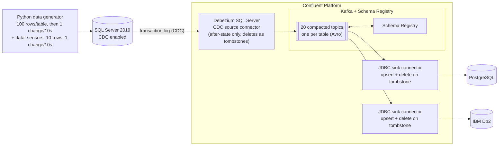

# Database replication demo: SQL Server → Confluent Platform → PostgreSQL + IBM Db2

## Why Kafka + CDC connectors for database replication?

Replicating a database used to mean nightly batch exports, hand-written ETL jobs, triggers on source tables or point-to-point tools, one per source/target pair. **Change data capture (CDC) into Kafka** replaces all of that with one simple, event-driven pattern:

> **read the database's transaction log once → publish every change as an event to Kafka → let any number of targets apply those events, whenever they want.**

**What you get**

* **Near-real-time, low impact on the source.** CDC connectors read the transaction log instead of querying tables or adding triggers, so changes (inserts, updates, deletes) show up in the targets in seconds, with no extra load on the application's tables and no `updated_at` polling.
* **Simple to build, no code.** The pipeline is just configuration: one source connector and one sink connector per target. In this demo the *same* sink config serves every table, even though each table has a different primary key (`pk.mode=record_key`), so adding the 100th or 600th table is a config change, not a project.
* **Simple to operate.** Snapshot-then-stream (initial load, then continuous changes) is built in; connectors track their own offsets, restart where they left off and are managed over a REST API or in Control Center. Failed or paused targets don't affect the source.
* **Decoupled and fan-out by design.** Kafka sits between source and targets as a durable, replayable buffer. The source is read once, whether it feeds one target or ten: here PostgreSQL *and* IBM Db2 consume the very same topics. Adding another target (a warehouse, a search index, a cache, another region) means adding a sink, with zero changes to the source or to the existing targets.
* **Heterogeneous by nature.** Source and targets don't need to speak the same dialect: SQL Server in, PostgreSQL and Db2 out, with types mapped through a common Avro schema. The same pattern works for Oracle, MySQL, MongoDB, cloud warehouses and more.
* **Correct and idempotent.** Inserts and updates are applied as **upserts** and deletes as **tombstones**, keyed by the table's primary key. Delivery is at-least-once, but because applying the same change twice gives the same result, the targets converge to the source's state, and a restart or replay never creates duplicates.
* **Replay and recovery for free.** Topics are compacted, so Kafka always keeps the latest state of every row. A new or rebuilt target can be bootstrapped just by reading the topic from the beginning, with no new load on the source database.
* **Schemas are managed, not guessed.** Schema Registry stores the Avro schema of every table and enforces compatibility rules, so producers and consumers evolve safely and every consumer knows exactly what a record looks like.
* **Scales when you need it.** Throughput scales with topic partitions and connector tasks, ordering is preserved per primary key, and the same topics feed more than databases: stream processing (Flink, ksqlDB), analytics, microservices and event-driven applications can all use the very same change stream.
* **Observable.** Control Center shows connector health, topics, schemas, consumer lag and throughput end to end, so you can answer "is replication caught up?" at a glance.
* **Run it your way.** This demo runs on Confluent Platform in Docker; the same pattern is available fully managed on Confluent Cloud (SQL Server CDC source, PostgreSQL / JDBC sinks), where there is no Connect cluster to operate.

**Good to know:** replication is asynchronous (eventually consistent; lag is typically a few seconds, and with SQL Server it includes the CDC capture job's polling interval, 5 s by default); CDC captures committed row changes, so schema changes (DDL) on the source need a planned rollout to the targets; and each target table needs a primary key (or unique key) for upserts and deletes to find the right row.

**In this demo** a generator keeps SQL Server busy with inserts, updates and deletes across 20 tables, and you can watch every change appear in PostgreSQL and Db2 within seconds (CloudBeaver, `verify.sh`, Control Center).



* **20 tables**: 19 "business" tables with deliberately different primary keys (identity INT/BIGINT/SMALLINT, CHAR/VARCHAR natural keys, UUID strings, composite keys including a DATE part) plus the small live-demo table [`data_sensors`](#easy-to-watch-table-data_sensors). See [Replicated tables](#replicated-tables).
* **Data generator** creates the schema, enables CDC, seeds **100 rows per business table** (10 for `data_sensors`), then performs **one insert / update / delete every 10 seconds** on a random business table (only leaf tables are deleted, so FKs are never violated). A second stream changes `data_sensors` every 10 seconds. Both intervals are configurable (see below).
* **One connector config per target, identical for all 20 tables**: no per-table `pk.fields`.

## Run

```bash
./start.sh                 # (starts Colima if installed,) wipes old volumes, builds + starts everything (~3-5 min)
./deploy-connectors.sh     # SQL Server CDC source + Postgres sink + Db2 sink   (or: source | sinks)
./verify.sh                # per-table row counts: SQL Server vs Postgres vs Db2 (re-run if a table is 1-2 rows off: changes in flight)
docker compose logs -f data-generator   # or docker-compose, see Requirements
./stop.sh                  # remove everything (and stop Colima)
```

UIs / endpoints:

| What | URL |
|---|---|
| **CloudBeaver** (web SQL client, no login needed; admin `cbadmin` / `Admin123`) | http://localhost:8978 |
| Control Center | http://localhost:9021 |
| Kafka Connect REST | http://localhost:8083 |
| Schema Registry | http://localhost:8081 |

CloudBeaver comes with three pre-configured connections (shared with all users by `scripts/cloudbeaver-setup.sh`, which `start.sh` runs) in the folder *Replication demo*: **SQL Server (source)**, **PostgreSQL (target)** and **IBM Db2 (target)**. Open them to browse and query the tables side by side while the generator runs. JDBC drivers are downloaded on first connect, so the first click needs internet access.

Database credentials: SQL Server `sa / Password!123` (db `demo_db`), Postgres `postgres / postgres` (db `demo`), Db2 `db2inst1 / db2inst1-pwd` (db `demo`).

Ad-hoc queries:

```bash
docker exec postgres psql -U postgres -d demo -c 'select * from orders order by order_id desc limit 5'
docker exec db2 su - db2inst1 -c 'db2 connect to demo && db2 "select * from \"orders\" order by \"order_id\" desc fetch first 5 rows only"'
docker exec mssql /opt/mssql-tools18/bin/sqlcmd -C -S localhost -U sa -P 'Password!123' -d demo_db -Q 'select top 5 * from dbo.orders order by order_id desc'
```

Change speed: `OPS_INTERVAL_SECONDS` (business tables) and `SENSOR_INTERVAL_SECONDS` (`data_sensors`), both default 10. For a faster stream: `OPS_INTERVAL_SECONDS=1 SENSOR_INTERVAL_SECONDS=1 ./start.sh`, or change it on a running stack with `OPS_INTERVAL_SECONDS=2 docker compose up -d data-generator`.

## Easy-to-watch table: `data_sensors`

A tiny 10-row table that is always moving, handy for live demos. A dedicated generator stream changes it every 10 seconds (`SENSOR_INTERVAL_SECONDS`): ~70% **updates** (temperature, pressure, online, updated_at) and ~30% **replacements**, where one sensor is deleted and a new one inserted in the same transaction, so the table always holds exactly 10 rows and `sensor_id` keeps growing. It is replicated like every other table (the 19 business tables are unchanged and keep their own, separate stream).

```bash
# run in 3 terminals (or open the 3 connections in CloudBeaver) and watch them follow each other
docker exec mssql /opt/mssql-tools18/bin/sqlcmd -C -S localhost -U sa -P 'Password!123' -d demo_db -Q 'select * from dbo.data_sensors order by sensor_id'
docker exec postgres psql -U postgres -d demo -c 'select * from data_sensors order by sensor_id'
docker exec db2 su - db2inst1 -c 'db2 connect to demo > /dev/null && db2 "select * from \"data_sensors\" order by \"sensor_id\""'
```

## Replicated tables

<!-- TABLES:START -->
| # | Table | Primary key | Deletable | Notes |
|---|-------|-------------|-----------|-------|
| 1 | `countries` | `country_code` char(2) | no | Reference data, CHAR(2) natural key |
| 2 | `departments` | `dept_code` char(3) | no | CHAR(3) natural key |
| 3 | `customers` | `customer_id` int | no | INT IDENTITY key |
| 4 | `addresses` | `address_id` bigint | yes | BIGINT IDENTITY key |
| 5 | `product_categories` | `category_id` smallint | no | SMALLINT IDENTITY key |
| 6 | `suppliers` | `supplier_code` varchar(12) | no | VARCHAR(12) natural key ('SUP-123456') |
| 7 | `products` | `sku` varchar(20) | no | VARCHAR(20) natural key (SKU) |
| 8 | `warehouses` | `warehouse_code` char(5) | no | CHAR(5) natural key ('WH042') |
| 9 | `inventory` | `warehouse_code` char(5), `sku` varchar(20) | yes | Composite key (CHAR + VARCHAR) |
| 10 | `orders` | `order_id` bigint | no | BIGINT IDENTITY(1000) key |
| 11 | `order_items` | `order_id` bigint, `line_number` smallint | yes | Composite key (BIGINT + SMALLINT) |
| 12 | `payments` | `payment_id` varchar(36) | yes | UUID string key VARCHAR(36) |
| 13 | `shipments` | `shipment_id` bigint | yes | BIGINT IDENTITY(50000) key |
| 14 | `employees` | `employee_id` int | no | INT IDENTITY(10000) key |
| 15 | `timesheets` | `employee_id` int, `work_date` date | yes | Composite key (INT + DATE) |
| 16 | `invoices` | `invoice_number` varchar(16) | yes | VARCHAR(16) natural key ('INV-0000012345') |
| 17 | `support_tickets` | `ticket_id` bigint | yes | BIGINT IDENTITY(7000) key |
| 18 | `product_reviews` | `review_id` int | yes | INT IDENTITY key, TINYINT column |
| 19 | `vehicles` | `vin` char(17) | no | CHAR(17) natural key (VIN) |
| 20 | `data_sensors` | `sensor_id` int | yes | INT IDENTITY key; always 10 rows, replace-on-delete |
<!-- TABLES:END -->

## How the replication is configured

Source ([connectors/mssql-source-connector.json](connectors/mssql-source-connector.json)):

| Setting | Why |
|---|---|
| `io.debezium.connector.sqlserver.SqlServerConnector` | Debezium SQL Server CDC connector (3.x property names: `database.names`, `topic.prefix`, `schema.history.internal.*`) |
| `ExtractNewRecordState` with `drop.tombstones=false`, `delete.handling.mode=drop` | "After state only": inserts/updates arrive as the flat row, a delete arrives as a **tombstone** (key + null value) and the delete event itself is dropped. This is the self-managed equivalent of Cloud's `after.state.only=true`. |
| `tombstones.on.delete=true` | Debezium emits the tombstone the SMT then keeps |
| `RegexRouter` `mssql.demo_db.dbo.(.*)` → `$1` | Topic = table name, so the sinks create/find tables with the same name |
| `time.precision.mode=connect`, `decimal.handling.mode=precise` | Plain TIMESTAMP / DATE / DECIMAL types for the JDBC sinks |
| `topic.creation.default.cleanup.policy=compact` | Latest record per key is always retained |

Sinks ([postgres](connectors/postgres-sink-connector.json), [db2](connectors/db2-sink-connector.json)), same settings for all 20 topics:

| Setting | Why |
|---|---|
| `pk.mode=record_key`, `pk.fields` unset | PK columns = fields of each topic's Avro key, so every table can have a different key |
| `insert.mode=upsert` | Inserts and updates are the same operation |
| `delete.enabled=true` | Tombstone → `DELETE` (requires `record_key`). **In the self-managed JDBC sink this is `delete.enabled`; `delete.on.null` is the name used by the fully managed Confluent Cloud connector.** |
| `auto.create=false` | Targets are pre-created from the same spec. Every target table still needs a PK / unique constraint matching the source key, otherwise upsert and delete can't match rows. |

Notes
* Db2 tables use lowercase **quoted** identifiers so they match the topic/field names exactly (default `quote.sql.identifiers=always`); query them with quotes.
* Targets have PKs but no foreign keys: tables replicate independently and a child row can arrive before its parent.
* The table list above, `tables.txt`, DDL and connector JSON are generated from [data-generator/schema_spec.py](data-generator/schema_spec.py): edit the spec, then `python3 data-generator/gen_artifacts.py` (needs no extra packages).

## Requirements / caveats

* A container runtime with ~10 GB RAM available (SQL Server 2019 and Db2 are `linux/amd64`-only, so on Apple Silicon they run emulated: slow-ish first boot): Docker Desktop, or **Colima** on macOS (`brew install colima`). `start.sh` starts Colima (vz + Rosetta, 6 CPU / 12 GB; override with `COLIMA_CPU`, `COLIMA_MEMORY`, `COLIMA_DISK`) and `stop.sh` stops it again (`KEEP_COLIMA=1 ./stop.sh` keeps the VM). Without Colima installed both scripts just use whatever Docker is running.
* `docker compose` (plugin) or the standalone `docker-compose` binary: the scripts use whichever exists.
* If `~/.docker/config.json` still references Docker Desktop's credential helper (`docker-credential-desktop`) and it isn't installed, the scripts use a clean project-local client config (`.docker-config/`, git-ignored) so image pulls don't fail. Your global config is not modified.
* Versions are overridable: `CP_VERSION` (default 8.2.0), `DEBEZIUM_SQLSERVER_VERSION` (3.1.2), `JDBC_CONNECTOR_VERSION` (latest), `CP_PROMETHEUS` / `CP_ALERTMANAGER` / `CP_C3` (2.7.0).
* Db2: the image's setup scripts need `su - db2inst1` to give a login shell, which is not the case on every VM (Colima). The `db2-init/db2-wrapper` script is mounted over the `db2*` commands so the database always gets created.
* Reset everything: `./stop.sh` (removes volumes and stops Colima). `./start.sh` also wipes old volumes first, so every start is a clean demo.
* Connector configs contain demo passwords in plain text: this stack is for local demos only.
