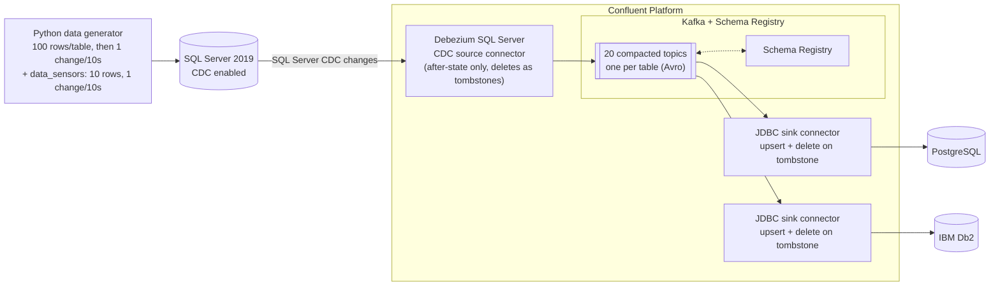
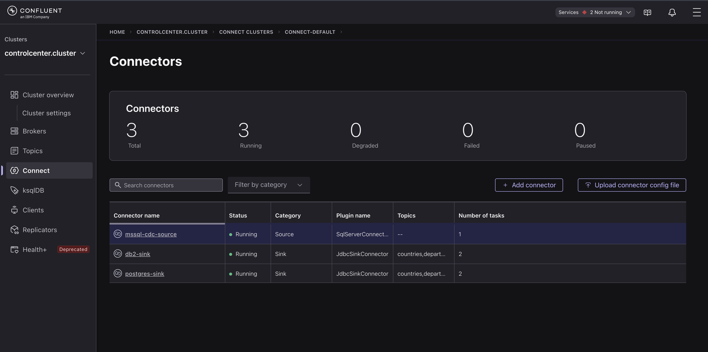
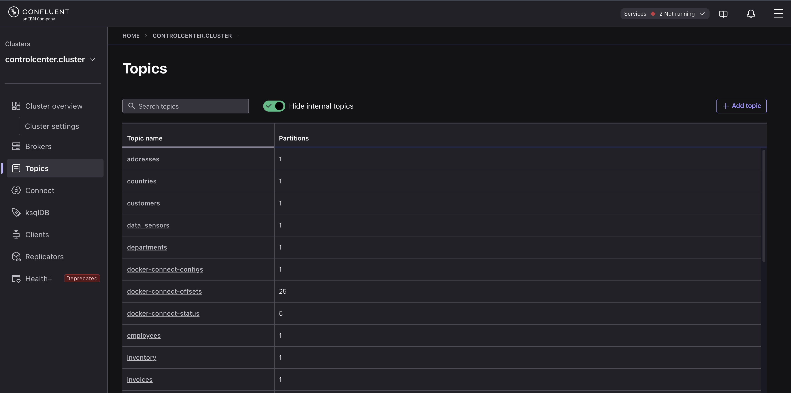
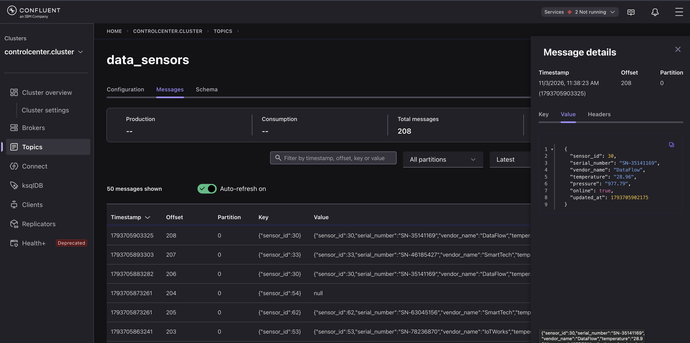
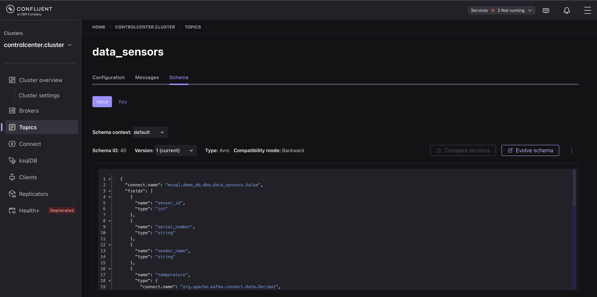
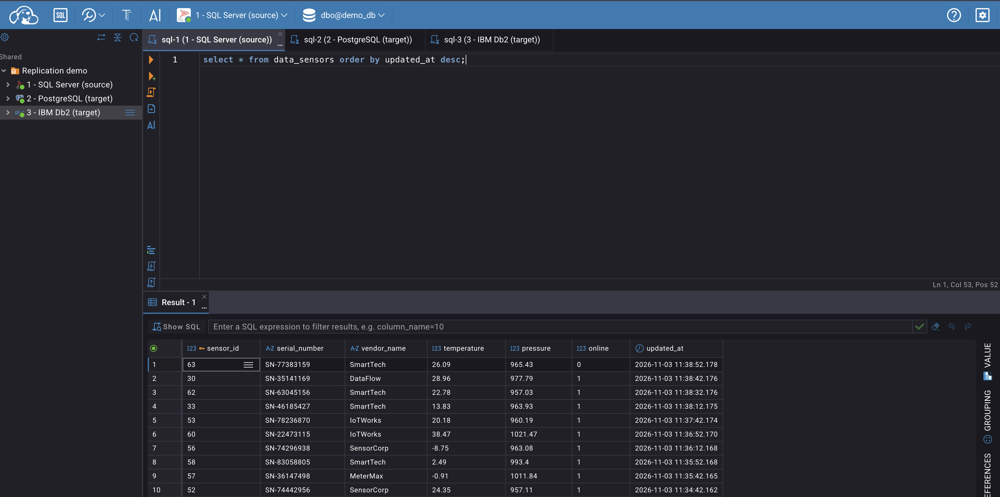
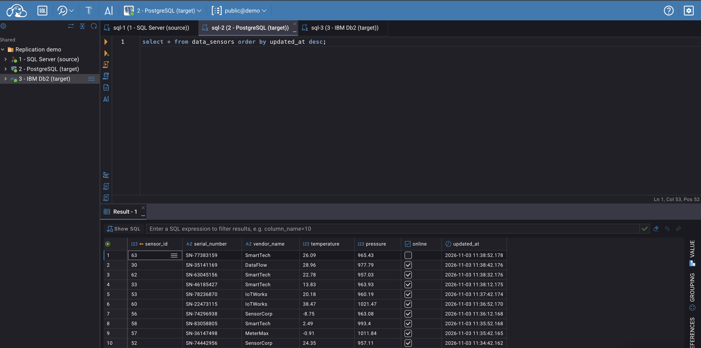
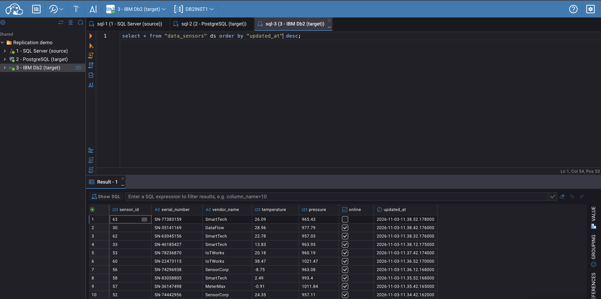

# Database replication demo: SQL Server → Confluent Platform → PostgreSQL + IBM Db2

## Replicate once. Connect many targets.

This demo shows how Confluent can act as a shared event-streaming layer for database replication. A CDC source captures committed changes from SQL Server and publishes them to Kafka. Independent sink connectors then apply those changes to PostgreSQL and IBM Db2.

Instead of building and maintaining a separate point-to-point replication path for every source/target pair, the pattern separates change capture from change delivery:

> **Capture changes once → make them durable and reusable in Kafka → let each target consume and apply them independently.**

That gives teams a common foundation for keeping operational stores aligned today and extending the same streams to analytics, search, caches, services, or additional regions later.

### What this demonstrates

* **Low-latency change propagation with a CDC-based approach.** The SQL Server connector captures changes through SQL Server CDC rather than repeatedly polling application tables. The SQL Server CDC capture job, connector processing, Kafka and sink throughput all affect end-to-end latency; this demo is designed to make the flow visible, not to promise a fixed replication SLA. The initial snapshot also reads existing table data.
* **Configuration-led integration.** The replication path uses connectors rather than custom application code to move and apply rows. The demo still includes code for generating data and preparing the databases; it is the replication pipeline itself that is connector-configured.
* **Independent targets.** PostgreSQL and Db2 consume the same Kafka topics through separate sink connectors. A target can be added without changing the source connector or the existing target connectors. Kafka buffers changes between capture and delivery, so a lagging sink does not immediately block the source; retention, storage capacity and connector health still need to be monitored.
* **A pattern that handles different key designs.** The demo uses one sink configuration per target across all 20 topics, even though tables have different primary keys. `pk.mode=record_key` uses the fields in each record key, so no table-specific `pk.fields` setting is needed. Every target table still needs a primary/unique key that matches the source key.
* **Idempotent row application.** Inserts and updates are applied as upserts; deletes are represented by tombstones and applied using the record key. Delivery is at least once, so records can be replayed or retried. With stable keys and correctly configured upserts/deletes, reprocessing converges on the same row state rather than creating duplicate rows.
* **A reusable, replayable change stream.** Kafka retains the change topics independently of the source and sinks. The demo configures topics for compaction, allowing Kafka to retain the latest value per key as compaction runs. A new sink can use retained topics to rebuild current row state, subject to topic retention, tombstone handling and the target's key/table configuration. Compaction is asynchronous; it is not an immediate snapshot service or a substitute for retention planning.
* **Governed schemas.** Schema Registry stores the Avro schemas used by the demo. Teams can configure compatibility policies to control schema evolution; the policy needs to be selected and maintained to match the application's rollout approach.
* **A foundation for more than replication.** The same topics can be consumed by stream processing, microservices and other event-driven applications. Throughput and parallelism depend on topic partitions, connector tasks, source characteristics and sink capacity. Ordering is maintained within a Kafka partition; records with the same key should be routed to the same partition when per-key ordering is required.
* **Operational visibility.** Control Center provides views into Kafka topics and platform activity; Connect and connector metrics help track connector health and lag. Use the relevant views together to understand where replication is progressing or falling behind.
* **A path to managed services.** This demo runs self-managed connectors on Confluent Platform in Docker. Confluent Cloud offers fully managed SQL Server CDC V2 and PostgreSQL Sink connectors, so teams can evaluate a managed path for those legs without operating their own Connect workers. The Db2 leg and this local configuration should be validated separately for the intended Cloud deployment, including connector availability, networking, schemas and database-specific type mapping.

**Good to know:** replication is asynchronous and the targets can temporarily lag the source. SQL Server CDC capture-job polling contributes to latency (the SQL Server default is 5 seconds, unless changed). The connector captures row changes, not a complete target-side DDL deployment process; plan and coordinate schema changes across the source, schemas and target tables. Each target table needs a compatible primary/unique key for reliable upserts and deletes.

**Demo scope:** the generator changes data across 20 tables so the end-to-end behavior is easy to inspect. This demonstrates the configuration pattern, including heterogeneous keys; it is not a 600-table throughput or sizing benchmark. Validate performance, task/partition sizing, database capacity and schema-management procedures with a workload representative of your environment.

## Architecture



* **20 tables:** 19 business tables with deliberately different primary keys (identity INT/BIGINT/SMALLINT, CHAR/VARCHAR natural keys, UUID strings, and composite keys including a DATE part), plus the small live-demo table [`data_sensors`](#easy-to-watch-table-data_sensors). See [Replicated tables](#replicated-tables).
* **Data generator:** creates the schema, enables CDC, seeds **100 rows per business table** (10 for `data_sensors`), then performs **one insert, update or delete every 10 seconds** on a random business table. Deletes are restricted to leaf tables so foreign-key constraints are not violated at the source. A second stream changes `data_sensors` every 10 seconds. Both intervals are configurable (see below).
* **One connector configuration per target, shared across all 20 topics:** no per-table `pk.fields` setting is required because the sink reads the key fields from each record key.

## Run

> **Reset warning:** `./start.sh` removes old volumes before starting, so existing local demo data is discarded. Use this only when you want a clean demo environment.

```bash
./start.sh # (starts Colima if installed,) resets volumes, builds + starts everything (~3-5 min)
./deploy-connectors.sh # SQL Server CDC source + Postgres sink + Db2 sink (or: source | sinks)
./verify.sh # per-table row counts: SQL Server vs Postgres vs Db2 (re-run if a table is 1-2 rows off: changes in flight)
docker compose logs -f data-generator # or docker-compose, see Requirements
./stop.sh # remove everything (and stop Colima)
```

UIs / endpoints:

| What | URL |
|---|---|
| **CloudBeaver** (web SQL client, no login needed; admin `cbadmin` / `Admin123`) | http://localhost:8978 |
| Control Center | http://localhost:9021 |
| Kafka Connect REST | http://localhost:8083 |
| Schema Registry | http://localhost:8081 |

CloudBeaver comes with three pre-configured connections (shared with all users by `scripts/cloudbeaver-setup.sh`, which `start.sh` runs) in the folder *Replication demo*: **SQL Server (source)**, **PostgreSQL (target)** and **IBM Db2 (target)**. Open them to browse and query the tables side by side while the generator runs. JDBC drivers are downloaded on first connect, so the first click needs internet access.

Database credentials: SQL Server `sa / Password!123` (db `demo_db`), Postgres `postgres / postgres` (db `demo`), Db2 `db2inst1 / db2inst1-pwd` (db `demo`). These are demo credentials; do not reuse them outside this local environment.

Ad-hoc queries:

```bash
docker exec postgres psql -U postgres -d demo -c 'select * from orders order by order_id desc limit 5'
docker exec db2 su - db2inst1 -c 'db2 connect to demo && db2 "select * from \"orders\" order by \"order_id\" desc fetch first 5 rows only"'
docker exec mssql /opt/mssql-tools18/bin/sqlcmd -C -S localhost -U sa -P 'Password!123' -d demo_db -Q 'select top 5 * from dbo.orders order by order_id desc'
```

Change speed: `OPS_INTERVAL_SECONDS` (business tables) and `SENSOR_INTERVAL_SECONDS` (`data_sensors`), both default 10. For a faster stream: `OPS_INTERVAL_SECONDS=1 SENSOR_INTERVAL_SECONDS=1 ./start.sh`, or change it on a running stack with `OPS_INTERVAL_SECONDS=2 docker compose up -d data-generator`.

## Easy-to-watch table: `data_sensors`

A small 10-row table that is always changing, handy for live demos. A dedicated generator stream changes it every 10 seconds (`SENSOR_INTERVAL_SECONDS`): about 70% **updates** (temperature, pressure, online, updated_at) and 30% **replacements**, where one sensor is deleted and a new one inserted in the same transaction. The table therefore stays at exactly 10 rows while `sensor_id` keeps growing. It is replicated like every other table; the 19 business tables are unchanged and keep their own, separate stream.

```bash
# Run in 3 terminals (or open the 3 connections in CloudBeaver) and watch them follow each other
docker exec mssql /opt/mssql-tools18/bin/sqlcmd -C -S localhost -U sa -P 'Password!123' -d demo_db -Q 'select * from dbo.data_sensors order by sensor_id'
docker exec postgres psql -U postgres -d demo -c 'select * from data_sensors order by sensor_id'
docker exec db2 su - db2inst1 -c 'db2 connect to demo > /dev/null && db2 "select * from \"data_sensors\" order by \"sensor_id\""'
```

## See it in action

**1. Three connectors, all running** (Control Center → Connect): the SQL Server CDC source and the Db2 and PostgreSQL JDBC sinks.



**2. One topic per table** (Control Center → Topics): the source connector creates a compacted topic named after each table, here `data_sensors`, `customers`, `employees`, ...



**3. The change stream** (topic `data_sensors` → Messages): the key is the primary key (`{"sensor_id":30}`) and the value is the flat after-state of the row, with no before/after envelope. A **delete** shows up as a record with the same kind of key and a `null` value, a *tombstone* (see `sensor_id` 54); the next record is the replacement sensor inserted in the same transaction.



**4. The schema** (topic `data_sensors` → Schema): Schema Registry holds the Avro schema generated from the SQL Server table (`mssql.demo_db.dbo.data_sensors.Value`), with `Decimal` logical types for `temperature` and `pressure` and backward compatibility enforced.



**5. Same data, three databases** (CloudBeaver, query `select * from data_sensors order by updated_at desc`): the source and both targets hold identical rows, with identical keys, values and `updated_at` timestamps. (`online` is a `BIT` in SQL Server, shown as 0/1, and a `BOOLEAN` in PostgreSQL and Db2.)

SQL Server (source):



PostgreSQL (target):



IBM Db2 (target):



## Replicated tables

<!-- TABLES:START -->
| # | Table | Primary key | Deletable | Notes |
|---|-------|-------------|-----------|-------|
| 1 | `countries` | `country_code` char(2) | no | Reference data, CHAR(2) natural key |
| 2 | `departments` | `dept_code` char(3) | no | CHAR(3) natural key |
| 3 | `customers` | `customer_id` int | no | INT IDENTITY key |
| 4 | `addresses` | `address_id` bigint | yes | BIGINT IDENTITY key |
| 5 | `product_categories` | `category_id` smallint | no | SMALLINT IDENTITY key |
| 6 | `suppliers` | `supplier_code` varchar(12) | no | VARCHAR(12) natural key ('SUP-123456') |
| 7 | `products` | `sku` varchar(20) | no | VARCHAR(20) natural key (SKU) |
| 8 | `warehouses` | `warehouse_code` char(5) | no | CHAR(5) natural key ('WH042') |
| 9 | `inventory` | `warehouse_code` char(5), `sku` varchar(20) | yes | Composite key (CHAR + VARCHAR) |
| 10 | `orders` | `order_id` bigint | no | BIGINT IDENTITY(1000) key |
| 11 | `order_items` | `order_id` bigint, `line_number` smallint | yes | Composite key (BIGINT + SMALLINT) |
| 12 | `payments` | `payment_id` varchar(36) | yes | UUID string key VARCHAR(36) |
| 13 | `shipments` | `shipment_id` bigint | yes | BIGINT IDENTITY(50000) key |
| 14 | `employees` | `employee_id` int | no | INT IDENTITY(10000) key |
| 15 | `timesheets` | `employee_id` int, `work_date` date | yes | Composite key (INT + DATE) |
| 16 | `invoices` | `invoice_number` varchar(16) | yes | VARCHAR(16) natural key ('INV-0000012345') |
| 17 | `support_tickets` | `ticket_id` bigint | yes | BIGINT IDENTITY(7000) key |
| 18 | `product_reviews` | `review_id` int | yes | INT IDENTITY key, TINYINT column |
| 19 | `vehicles` | `vin` char(17) | no | CHAR(17) natural key (VIN) |
| 20 | `data_sensors` | `sensor_id` int | yes | INT IDENTITY key; always 10 rows, replace-on-delete |
<!-- TABLES:END -->

## How the replication is configured

Source ([connectors/mssql-source-connector.json](connectors/mssql-source-connector.json)):

| Setting | Why |
|---|---|
| `io.debezium.connector.sqlserver.SqlServerConnector` | Debezium SQL Server CDC connector (3.x property names: `database.names`, `topic.prefix`, `schema.history.internal.*`) |
| `ExtractNewRecordState` with `drop.tombstones=false`, `delete.handling.mode=drop` | Flattens inserts/updates to the row state. The delete event is dropped while the tombstone is retained (key + null value), so the sink can delete the target row. This is the self-managed equivalent of Cloud's `after.state.only=true` for this demo's output pattern. |
| `tombstones.on.delete=true` | Debezium emits a tombstone for each delete; the SMT configuration above keeps it for the sink. |
| `RegexRouter` `mssql.demo_db.dbo.(.*)` → `$1` | Topic name becomes the table name, so sinks can create/find the corresponding target table. |
| `time.precision.mode=connect`, `decimal.handling.mode=precise` | Maps time and decimal values for the JDBC sinks; validate mappings against the target database types for production use. |
| `topic.creation.default.cleanup.policy=compact` | Enables compaction so Kafka can retain the latest record per key as compaction runs. Tombstones and topic retention still need to be considered when rebuilding consumers. |

Sinks ([postgres](connectors/postgres-sink-connector.json), [db2](connectors/db2-sink-connector.json)), same settings for all 20 topics:

| Setting | Why |
|---|---|
| `pk.mode=record_key`, `pk.fields` unset | Uses the fields in each topic's Avro key as the primary key, so tables can have different keys without per-table configuration. |
| `insert.mode=upsert` | Applies inserts and updates idempotently using the key. |
| `delete.enabled=true` | Converts a tombstone into a `DELETE` using the record key. **For the self-managed JDBC sink this is `delete.enabled`; `delete.on.null` is the property name used by the fully managed Confluent Cloud PostgreSQL Sink.** |
| `auto.create=false` | Target tables are pre-created from the same spec. Each target table needs a primary/unique constraint matching the source key for upsert and delete operations to identify the row. |

Notes:

* Db2 tables use lowercase **quoted** identifiers so they match the topic/field names exactly (default `quote.sql.identifiers=always`); query them with quotes.
* Targets have primary keys but no foreign keys: tables replicate independently, and a child row can arrive before its parent.
* The table list above, `tables.txt`, DDL and connector JSON are generated from [data-generator/schema_spec.py](data-generator/schema_spec.py): edit the spec, then run `python3 data-generator/gen_artifacts.py` (no extra packages needed).

## Requirements / caveats

* A container runtime with about 10 GB RAM available (SQL Server 2019 and Db2 are `linux/amd64`-only, so on Apple Silicon they run emulated and the first boot can be slow): Docker Desktop, or **Colima** on macOS (`brew install colima`). `start.sh` starts Colima (vz + Rosetta, 6 CPU / 12 GB; override with `COLIMA_CPU`, `COLIMA_MEMORY`, `COLIMA_DISK`) and `stop.sh` stops it again (`KEEP_COLIMA=1 ./stop.sh` keeps the VM). Without Colima installed, both scripts use whatever Docker runtime is running.
* `docker compose` (plugin) or the standalone `docker-compose` binary: the scripts use whichever exists.
* If `~/.docker/config.json` still references Docker Desktop's credential helper (`docker-credential-desktop`) and it isn't installed, the scripts use a clean project-local client config (`.docker-config/`, git-ignored) so image pulls don't fail. Your global config is not modified.
* Versions are overridable: `CP_VERSION` (default 8.2.0), `DEBEZIUM_SQLSERVER_VERSION` (3.1.2), `JDBC_CONNECTOR_VERSION` (latest), `CP_PROMETHEUS` / `CP_ALERTMANAGER` / `CP_C3` (2.7.0).
* Db2: the image's setup scripts need `su - db2inst1` to give a login shell, which is not the case on every VM (Colima). The `db2-init/db2-wrapper` script is mounted over the `db2*` commands so the database is always created.
* Reset everything: `./stop.sh` removes volumes and stops Colima. `./start.sh` also wipes old volumes first, so every start is a clean demo.
* Connector configs contain demo passwords in plain text: this stack is for local demos only. Do not use these credentials or configurations as production secrets.

## Confluent Cloud references

* [Microsoft SQL Server CDC Source V2 (Debezium) for Confluent Cloud](https://docs.confluent.io/cloud/current/connectors/cc-microsoft-sql-server-source-cdc-v2-debezium/cc-microsoft-sql-server-source-cdc-v2-debezium.html)
* [PostgreSQL Sink for Confluent Cloud](https://docs.confluent.io/cloud/current/connectors/cc-postgresql-sink.html)

## Confluent Platform references

* [Debezium SQL Server CDC Source Connector for Confluent Platform](https://docs.confluent.io/kafka-connectors/debezium-sqlserver-source/current/overview.html)
* [JDBC Sink Connector for Confluent Platform](https://docs.confluent.io/kafka-connectors/jdbc/current/sink-connector/overview.html)
