# Database replication with Confluent Cloud: SQL Server → Kafka + Schema Registry → PostgreSQL + IBM Db2

Same demo as the [local-only version](../README.md) (same 20 tables, data generator, connectors and databases), but the Kafka cluster and Schema Registry are provisioned in Confluent Cloud by Terraform. The data plane (Python generator, three databases and two self-managed Kafka Connect clusters, one for the CDC source and one for the sinks) runs locally in Docker:

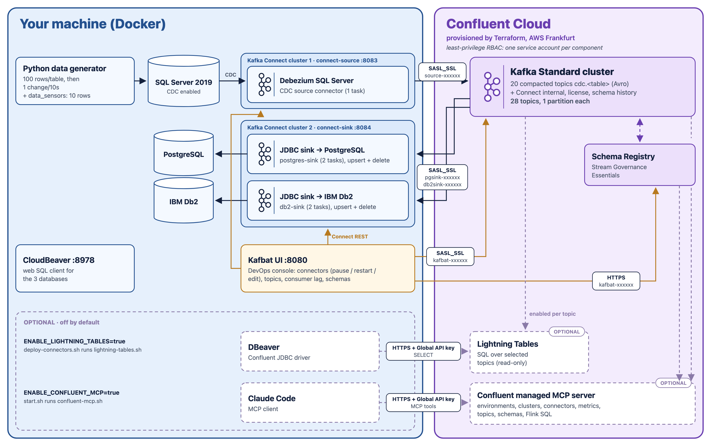

The diagram shows a single Kafka Connect box; in this version it is split into two clusters: `connect-source` (the Debezium CDC source) and `connect-sink` (the PostgreSQL and Db2 sinks), see [Distributing the self-managed connectors](#distributing-the-self-managed-connectors-across-two-or-more-vms).

The two optional integrations on the right of the diagram are covered in [Query topics with Lightning Tables and DBeaver](#query-topics-with-lightning-tables-and-dbeaver) and [Confluent MCP server with Claude](#confluent-mcp-server-with-claude): both authenticate with a Global API key and reach Confluent Cloud directly over HTTPS, not through the local Docker stack.

The demo reuses the parent folder’s data generator, database initialization scripts, Kafka Connect image, CloudBeaver setup and verification script. This folder adds the Confluent Cloud configuration and Cloud-aware orchestration:

| File | What |
|---|---|
| `terraform/` | Confluent Cloud environment, Kafka cluster, Schema Registry, service accounts, RBAC role bindings, API keys and topics |
| `docker-compose.yml` | Databases, data generator, CloudBeaver and two self-managed Kafka Connect clusters (`connect-source` :8083, `connect-sink` :8084) connected to Confluent Cloud (no local Kafka broker, Schema Registry or Control Center) |
| `connectors/` | The same three connector configurations, with Confluent Cloud credentials injected from the worker environment (`${env:CC_...}`), so the files contain no secrets |
| `start.sh`, `stop.sh`, `deploy-connectors.sh`, `verify.sh` | Cloud-aware versions of the local scripts |
| `.env_example` | Template for the credentials (Terraform, Lightning Tables, MCP): copy it to `.env` |
| `lightning-tables.sh` | Enables Lightning Tables on a few topics, downloads the JDBC driver and writes the DBeaver connection file |
| `scripts/` | Helpers (`gen_connectors.py` regenerates `connectors/`) |

## What Terraform creates

| Resource | Details |
|---|---|
| Environment | `db-replication-xxxxxx` (random 6-character suffix), with Stream Governance Essentials |
| Kafka cluster | Standard cluster, AWS Frankfurt (`eu-central-1`), single zone |
| Schema Registry | Stream Governance Essentials Schema Registry, provisioned for the environment; Terraform reads back its endpoint |
| Service accounts | Least privilege, one identity per component, each with its own Kafka and Schema Registry API key (see the table below). `app-manager` is used only by Terraform to create topics |
| Topics | One compacted, single-partition Kafka topic per table (20, named `cdc.<table>`), Kafka Connect internal topics (3 per Connect cluster), the `_confluent-command` license topic and the Debezium schema history topic |

### Service accounts and RBAC per connector

One service account per connector, each with its own **Kafka API key** and **Schema Registry API key** (`terraform/service_accounts.tf`). Every row is one role binding.

**Names carry the environment's suffix.** Terraform generates one random 6-character suffix per deployment and appends it to the environment, the service accounts and the API keys, so all resources of one run share it. For an environment called `db-replication-1a2b3c`, the accounts in the table below appear in the Confluent Cloud console (**Accounts & access**) as `source-1a2b3c`, `pgsink-1a2b3c`, `db2sink-1a2b3c`, `connect-worker-1a2b3c` and `app-manager-1a2b3c`, and the API keys as `<account>-kafka-key-1a2b3c` / `<account>-sr-key-1a2b3c`. `xxxxxx` stands for that suffix in the table. This lets several copies of the demo coexist in one organization and tells you which environment an account belongs to.

| Connector (Connect cluster) | Service account | Access | Resource | Resource name | Role |
|---|---|---|---|---|---|
| `mssql-cdc-source` (`connect-source`) | `source-xxxxxx` | **read/write** | Kafka topic | `cdc.*` | `DeveloperWrite` |
| | | read/write | Kafka topic | `mssql.schema-history` | `ResourceOwner` |
| | | **write** | Schema Registry subject | `cdc.*` | `DeveloperWrite` |
| `postgres-sink` (`connect-sink`) | `pgsink-xxxxxx` | **read only** | Kafka topic | `cdc.*` | `DeveloperRead` |
| | | read only | Kafka consumer group | `connect-postgres-sink` | `DeveloperRead` |
| | | **read only** | Schema Registry subject | `cdc.*` | `DeveloperRead` |
| `db2-sink` (`connect-sink`) | `db2sink-xxxxxx` | **read only** | Kafka topic | `cdc.*` | `DeveloperRead` |
| | | read only | Kafka consumer group | `connect-db2-sink` | `DeveloperRead` |
| | | **read only** | Schema Registry subject | `cdc.*` | `DeveloperRead` |
| both Connect workers (no connector) | `connect-worker-xxxxxx` | internal only | Kafka topic | `docker-connect-*` | `ResourceOwner` |
| | | internal only | Kafka topic | `_confluent-command` (Connect license) | `ResourceOwner` |
| | | internal only | Kafka consumer group | `db-replication-connect-*` | `ResourceOwner` |
| Terraform (provisioning only) | `app-manager-xxxxxx` | admin | Environment | whole environment | `EnvironmentAdmin` |

What this means in practice:

* **Sinks are read only**: they can consume `cdc.*` and read schemas, but cannot produce to any topic or register a schema, and each can only use its own consumer group (so `pgsink` cannot join or commit offsets for the Db2 sink's group).
* **The source is write only on data**: it can produce to `cdc.*` and register schemas for `cdc.*` subjects, but has no consumer group and cannot read other topics. It owns the Debezium schema history topic, which it must both write and read back.
* **The worker identity has no access to table data or Schema Registry**: it only manages the Connect internal topics and the worker groups.
* Because the source and sinks have separate credentials, revoking one (for example a compromised sink key) does not affect the others.

Each connector authenticates with its own account through `producer.override.*` / `consumer.override.*` and its own Avro converter settings (the workers run with `connector.client.config.override.policy=All`). A sink cannot write to a topic or register a schema, and the source cannot consume.

The environment as it appears in the Confluent Cloud console after `./start.sh`: the `cc-demo-main` Standard cluster running on AWS `eu-central-1`, 28 topics and the Essentials governance package. It shows 0 connectors because they run self-managed in your Docker, not in Confluent Cloud.

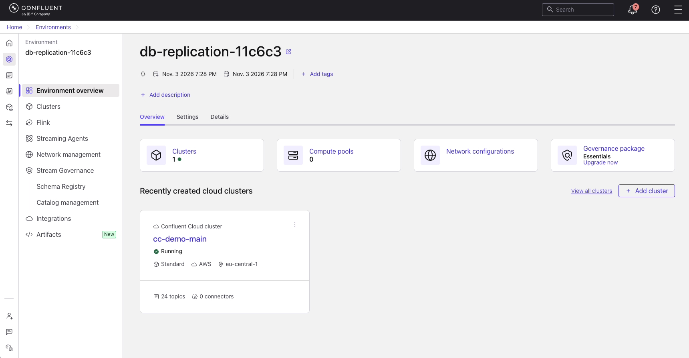

The settings are plain Terraform variables with defaults in [`terraform/vars.tf`](terraform/vars.tf) (`cc_cloud_provider`, `cc_cloud_region`, `cc_env_name`, `cc_cluster_name`, `cc_availability`, `stream_governance`). Override any of them with `TF_VAR_...`, for example to use another region:

```bash
TF_VAR_cc_cloud_region=eu-west-1 ./start.sh
```

## Prerequisites

* A **Confluent Cloud account** and a **Cloud API key scoped for Cloud resource management** (not a Kafka cluster or Schema Registry API key). Create it from Confluent Cloud’s **API keys** page by choosing **Add API key** and the **Cloud resource management** scope. The key owner needs sufficient permissions to create the resources managed by Terraform; for this demo, use an account with the required organization-level permissions. See Confluent’s [Manage API Keys in Confluent Cloud documentation](https://docs.confluent.io/cloud/current/security/authenticate/workload-identities/service-accounts/api-keys/manage-api-keys.html) for the current steps and role requirements.
* Docker, or **Colima** on macOS (`brew install colima`): `start.sh` starts it and `stop.sh` stops it (see the [main README](../README.md#requirements--caveats) for sizing and the Db2 note).
* **Terraform is optional.** If `terraform` is not installed, the scripts use the official `hashicorp/terraform` Docker image instead (force this with `TF_USE_DOCKER=1`). The repository must live under your home folder for this option because Colima shares only `$HOME` with the VM.
* *(Optional, for [Lightning Tables](#query-topics-with-lightning-tables-and-dbeaver) and the [MCP server](#confluent-mcp-server-with-claude))* a **Global API key** (organization-wide). Create it from **API keys** > **Add API key** > **My account** > **Global access**. A Cloud resource management key or a cluster-scoped key is rejected with `HTTP 401`.
* *(Optional, for Lightning Tables)* [DBeaver](https://dbeaver.io/download/) on the machine (Java 17 or later; DBeaver's bundled JRE is enough).
* Internet access for Confluent Cloud, Maven (Db2 JDBC driver) and container images.

## Run

Put your credentials in a `.env` file first, so nothing has to be typed or exported:

```bash
cd confluent_cloud
cp .env_example .env # then edit .env: fill in the values before running anything else
```

| Variable | Used by | Key type |
|---|---|---|
| `CONFLUENT_CLOUD_API_KEY` / `CONFLUENT_CLOUD_API_SECRET` | `start.sh`, `stop.sh` (Terraform) and `lightning-tables.sh` (enable topics) | Cloud resource management |
| `CONFLUENT_GLOBAL_API_KEY` / `CONFLUENT_GLOBAL_API_SECRET` | Lightning Tables JDBC driver and the Confluent MCP server | Global access |

`.env` is git-ignored. Variables already exported in your shell take precedence over the file, and the scripts prompt for any Terraform key that is still missing.

```bash
./start.sh # reads .env (or prompts for CONFLUENT_CLOUD_API_KEY / CONFLUENT_CLOUD_API_SECRET), provisions the Cloud resources, then starts the local databases, generator and the two Kafka Connect clusters
./deploy-connectors.sh # SQL Server CDC source + PostgreSQL sink + Db2 sink (or: source | sinks)
./verify.sh # live view of data_sensors on SQL Server, PostgreSQL and Db2, refreshed every 10s (Ctrl+C to stop); ./verify.sh counts = per-table row counts
./stop.sh # removes the local stack and asks whether to destroy the Cloud resources too
```

* Credentials are read from `.env` or the environment; otherwise `start.sh` prompts for the Terraform key (the secret is not echoed). The scripts never write them anywhere else. Terraform needs them again if you choose to destroy the Cloud resources with `./stop.sh`.
* At the end, `start.sh` prints the **Confluent Cloud console link** for the new Kafka cluster, the Schema Registry endpoint and the local URLs. CloudBeaver (`http://localhost:8978`) has the three database connections preloaded, as in the local demo.
* Non-interactive use: `ASSUME_YES=1 ./start.sh`, `DESTROY_CLOUD=1 ./stop.sh`, `KEEP_COLIMA=1 ./stop.sh`.
* `SKIP_TERRAFORM=1 ./start.sh` reuses the already deployed environment (`cloud.env`) without running Terraform.
* **Every start is a clean demo:** the local databases are recreated and Terraform recreates the empty Kafka topics, so SQL Server, Kafka and both targets begin in sync.
* The change intervals are the same as in the local demo: `OPS_INTERVAL_SECONDS` and `SENSOR_INTERVAL_SECONDS` (default 10 seconds).

Watch the demo in Confluent Cloud (topics, messages with tombstones, schemas and consumer lag for the two sink consumer groups) and compare the three databases in CloudBeaver. See the [main README](../README.md#see-it-in-action) for screenshots.

## Test it

Once `./start.sh` and `./deploy-connectors.sh` have finished and the connectors show `RUNNING`, check that the three databases follow each other:

**1. Live check:** `./verify.sh` shows `data_sensors` from SQL Server (source) and, below it, the same table from PostgreSQL and Db2, newest update first, refreshing every 10 seconds (`INTERVAL=5 ./verify.sh` to change it). Each target is flagged *in sync with source* or *DIFFERENT* (a difference right after a change is normal; it clears on the next refresh). For the row counts of all 20 tables, run `./verify.sh counts` once.

**2. CloudBeaver** (`http://localhost:8978`, no login needed): the *Replication demo* folder holds the three connections: **1 - SQL Server (source)**, **2 - PostgreSQL (target)** and **3 - IBM Db2 (target)**. Open an SQL editor on each connection and run the same query:

| Connection | Query |
|---|---|
| SQL Server | `select * from data_sensors order by updated_at desc;` |
| PostgreSQL | `select * from data_sensors order by updated_at desc;` |
| IBM Db2 | `select * from "data_sensors" order by "updated_at" desc;` (Db2 names are lowercase and quoted) |

`data_sensors` always has 10 rows and changes every 10 seconds. Rerun the query in all three tabs; the rows (and `sensor_id`s, as sensors are replaced) should match. The first connection to SQL Server or Db2 downloads the JDBC driver, so it needs internet access.

**3. Push your own change** and watch it arrive (SQL Server → Confluent Cloud → both targets). Run these statements on the SQL Server connection in CloudBeaver, then query the other two databases:

```sql
update dbo.customers set customer_tier = 'PLATINUM' where customer_id = 1; -- replicated as an upsert
delete from dbo.addresses where address_id = (select min(address_id) from dbo.addresses); -- replicated as a tombstone; the row disappears from both targets
```

**4. Confluent Cloud console** (the link is printed at the end of `start.sh`): open the Kafka cluster and inspect:

* **Topics** → `cdc.data_sensors` → **Messages**: the key is the primary key and the value is the row. A delete appears as a record with a `null` value (a tombstone). The **Schema** tab shows the Avro schema registered in Schema Registry.
* **Connectors**: none are listed in Confluent Cloud because the Kafka Connect clusters and connectors run in your Docker environment. **Consumers** shows the `connect-postgres-sink` and `connect-db2-sink` groups and their lag.
* **Environment** → **Stream Governance**: the Essentials Schema Registry, with one subject pair (`-key` / `-value`) per table.

What these look like once the connectors are running:

**Topics**: the 28 topics Terraform created (20 `cdc.` tables, the six Kafka Connect internal topics, the `_confluent-command` license topic and the Debezium schema history topic), one partition each.

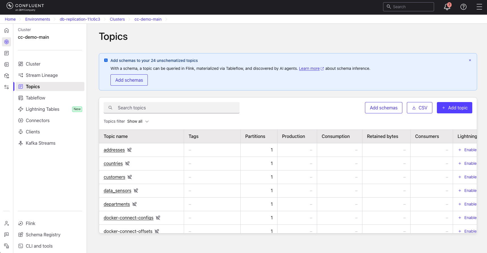

**Messages** of `data_sensors`: the key is the primary key (`sensor_id`) and the value is the flat row. Records with an empty value (`sensor_id` 5 and 13 here) are tombstones from sensors that were deleted; the next record is the replacement sensor inserted in the same transaction.

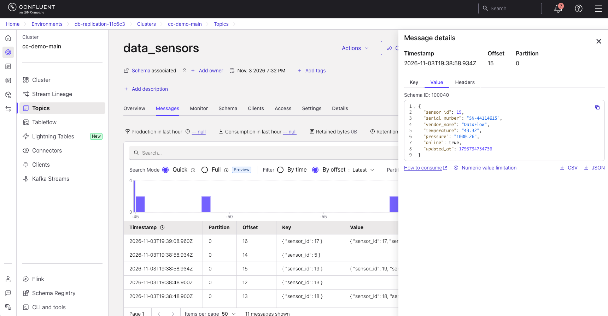

**Schema** of `data_sensors`: the Avro value schema registered in Schema Registry from the SQL Server table, with `Decimal` logical types for `temperature` and `pressure` and backward compatibility enforced.

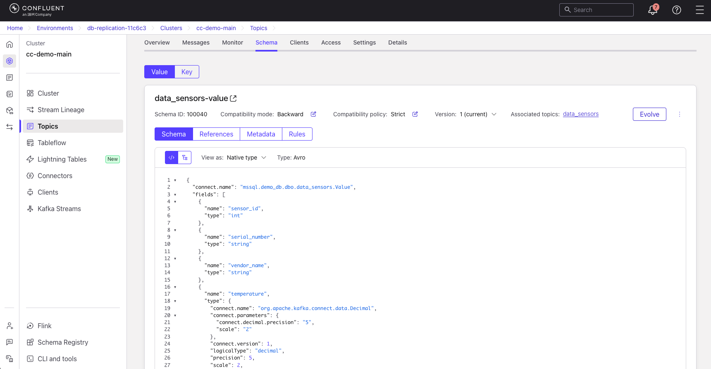

**Stream lineage**: the data flow end to end, from the Debezium source connector's producer through the table topics to the consumer groups of the two sink connectors (PostgreSQL and Db2).

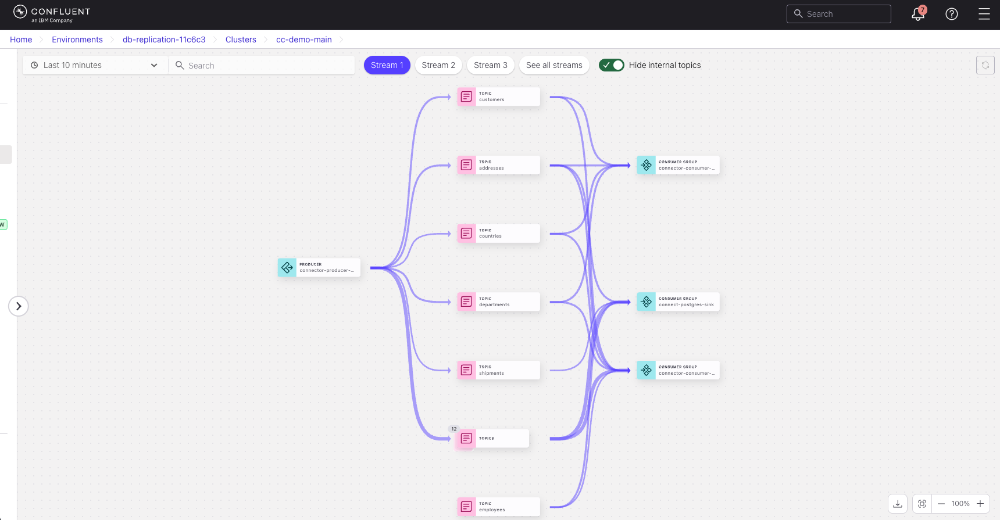

**5. Kafka Connect from the command line:** `curl -s localhost:8083/connectors?expand=status` (source cluster) and `curl -s localhost:8084/connectors?expand=status` (sink cluster), or `docker logs -f connect-source` / `docker logs -f connect-sink`.

## Visualise the data

The replicated data lives in three databases on your machine, so you can look at it either in a web SQL client (CloudBeaver) or straight from the command line.

### CloudBeaver (web)

Open **http://localhost:8978**. No login is needed: the *Replication demo* folder already contains the three connections (**1 - SQL Server (source)**, **2 - PostgreSQL (target)** and **3 - IBM Db2 (target)**), shared with everybody by `../scripts/cloudbeaver-setup.sh`, which `start.sh` runs. Click a connection, open an SQL editor (**SQL** button) and run the query from step 2 of [Test it](#test-it), one tab per database. The administrator login is `cbadmin` / `Admin123`. The first connection to SQL Server or Db2 downloads its JDBC driver, so it needs internet access.

The same `data_sensors` query on the source and on both targets returns identical rows (`online` is a `BIT` in SQL Server, shown as 0/1, and a `BOOLEAN` in PostgreSQL and Db2):

SQL Server (source):

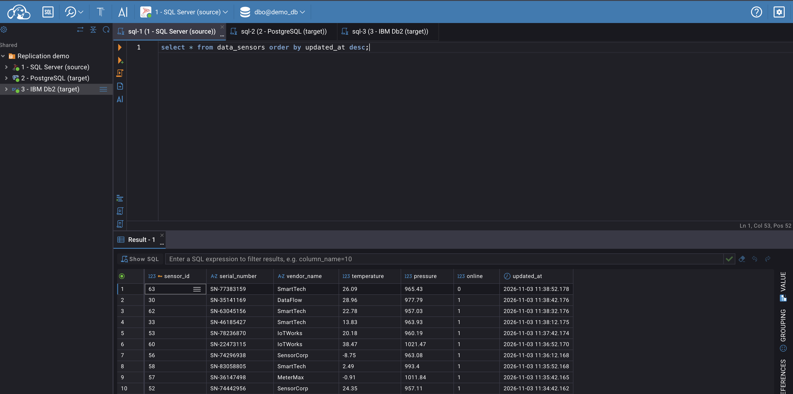

PostgreSQL (target):

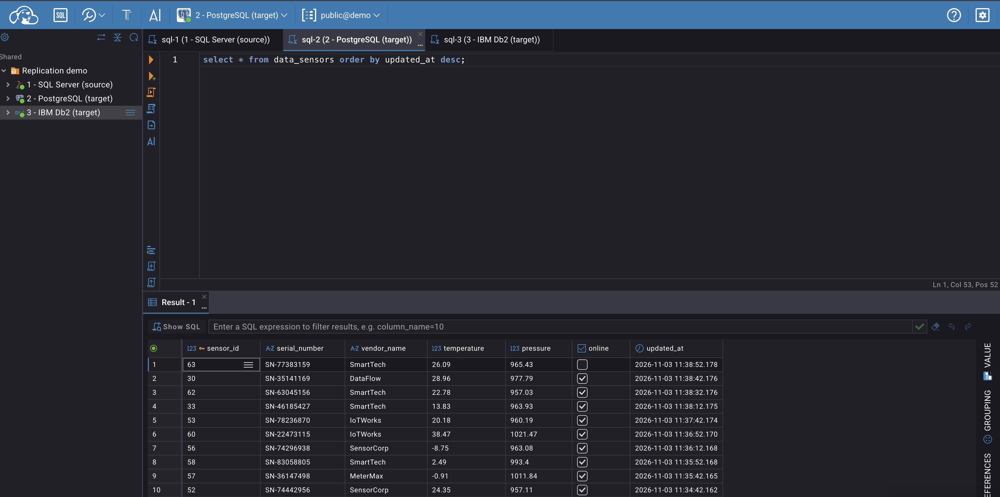

IBM Db2 (target):

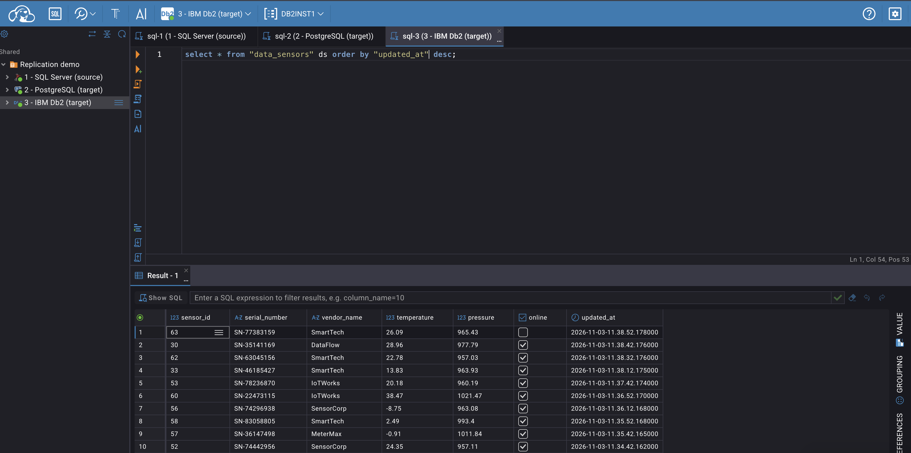

### Command line

The databases run in Docker containers, so `docker exec` is all you need (nothing to install). Any of the 20 tables works, here `orders`:

```bash
docker exec postgres psql -U postgres -d demo -c 'select * from orders order by order_id desc limit 5'
docker exec db2 su - db2inst1 -c 'db2 connect to demo && db2 "select * from \"orders\" order by \"order_id\" desc fetch first 5 rows only"'
docker exec mssql /opt/mssql-tools18/bin/sqlcmd -C -S localhost -U sa -P 'Password!123' -d demo_db -Q 'select top 5 * from dbo.orders order by order_id desc'
```

For the small, always-moving `data_sensors` table (10 rows, a change every 10 seconds; about 70% updates and 30% replacements where a sensor is deleted and a new one inserted), run these in 3 terminals (or in the 3 CloudBeaver tabs) and watch them follow each other:

```bash
docker exec mssql /opt/mssql-tools18/bin/sqlcmd -C -S localhost -U sa -P 'Password!123' -d demo_db -Q 'select * from dbo.data_sensors order by sensor_id'
docker exec postgres psql -U postgres -d demo -c 'select * from data_sensors order by sensor_id'
docker exec db2 su - db2inst1 -c 'db2 connect to demo > /dev/null && db2 "select * from \"data_sensors\" order by \"sensor_id\""'
```

Notes: Db2 table and column names are lowercase and **quoted** (`"orders"`, `"order_id"`). To see the changes arrive faster, shorten the generator intervals, for example `OPS_INTERVAL_SECONDS=1 SENSOR_INTERVAL_SECONDS=1 ./start.sh`, or on a running stack `OPS_INTERVAL_SECONDS=2 SENSOR_INTERVAL_SECONDS=2 docker compose up -d data-generator` (use `docker-compose` if you have the standalone binary).

## Query topics with Lightning Tables and DBeaver

[Lightning Tables](https://docs.confluent.io/cloud/current/lightning-tables/overview.html) turn Kafka topics into SQL tables that you can query with a plain `SELECT`, from any JDBC client, without a connector or a Flink compute pool. Here DBeaver on your machine queries the replicated topics straight from Confluent Cloud, with the new [Confluent JDBC driver](https://docs.confluent.io/cloud/current/lightning-tables/query/jdbc.html):

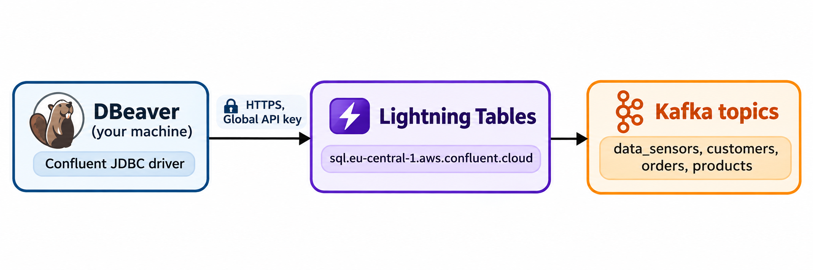

Requirements: an AWS cluster in a Lightning Tables region (this demo uses `eu-central-1`), a schema on the topic (Debezium has registered Avro schemas) and the Global API key from [Prerequisites](#prerequisites). The topics are compacted, so each table is in *upsert* mode and shows the latest row per key. The driver is read-only (`SELECT` only).

**1. Prepare** (after `./start.sh` and `./deploy-connectors.sh`, with `.env` filled in):

```bash
./lightning-tables.sh # enables cdc.data_sensors, cdc.customers, cdc.orders and cdc.products
TOPICS="cdc.orders cdc.payments" ./lightning-tables.sh # or pick your own topics
```

It enables Lightning Tables on the topics, downloads `confluent-jdbc-1.0.0.jar` into `drivers/`, writes `lightning-jdbc.properties` (permissions 600, git-ignored, holds the Global API key) and prints the DBeaver settings below with your absolute paths. Enabling takes several minutes: the status is under **Topics** > **Lightning Tables** in the console. `./lightning-tables.sh disable` turns it off again. The topics are recreated on every `./start.sh`, so run the script again after a restart.

**2. Register the driver in DBeaver:** **Database** > **Driver Manager** > **New**:

| Field | Value |
|---|---|
| Driver Name | `Confluent Lightning Tables` |
| Class Name | `io.confluent.jdbc.avatica.ConfluentJdbcDriver` |
| URL Template | `jdbc:confluent:lightning://?propertiesFile=/absolute/path/to/confluent_cloud/lightning-jdbc.properties` |
| Libraries | **Add File** > `confluent_cloud/drivers/confluent-jdbc-1.0.0.jar` |

Use a real absolute path in the URL (the script prints it): DBeaver reads `<...>` or `{...}` in a template as a placeholder and fails with *named capturing group is missing trailing '>'*. If it still complains, create the connection with **Connect by: URL** and paste the URL there.

**3. Create the connection** with that driver. Leave **Username** and **Password** empty: the endpoint, environment ID, cluster ID and Global API key all come from the properties file. Without a properties file, use the URL `jdbc:confluent:lightning://sql.eu-central-1.aws.confluent.cloud?environment-id=<env_id>&lkc-id=<lkc_id>` with the Global API key as the username and the secret as the password (IDs are in `cloud.env`).

**4. Query:** the navigator shows the environment ID as the catalog, the cluster ID as the schema and one table per enabled topic. Open an SQL editor and run:

```sql
SELECT * FROM `cdc.data_sensors` LIMIT 10;
SELECT customer_tier, COUNT(*) AS customers FROM `cdc.customers` GROUP BY customer_tier;
SELECT * FROM `cdc.orders` LIMIT 20;
```

The topic names contain a dot (`cdc.<table>`), so quote them with backticks (`` `cdc.orders` ``). Rerun `cdc.data_sensors` to see the data change every 10 seconds. Large results run asynchronously and fail instead of returning partial data, so add a `LIMIT` or a filter.

| Error | Cause |
|---|---|
| `HTTP 401 ... not a key that authenticates a whole organization` | The key is not a Global API key. Create one and update `.env` and `lightning-jdbc.properties` (rerun `./lightning-tables.sh`). |
| `HTTP 403` | The key's owner lacks read permission on the topic (for example ResourceOwner). |
| Table not found | Lightning Tables is still being enabled, or the topic was not enabled. |

## Confluent MCP server with Claude

The [Confluent Cloud managed MCP server](https://docs.confluent.io/cloud/current/ai/ai-tools/managed-mcp-server.html) is hosted by Confluent: nothing runs locally. It lets Claude inspect the environment and clusters, check and restart connectors and query metrics. The regional server also reads topics and schemas and runs Flink SQL. Use the same Global API key (`CONFLUENT_GLOBAL_API_KEY` in `.env`), as an HTTP Basic header.

**Claude Code** (run from `confluent_cloud/`; the header value is built from `.env` so the secret is not typed):

```bash
set -a; source .env; set +a
claude mcp add --transport http confluent-mcp-global https://api.confluent.cloud/mcp/v1 \
  --header "Authorization: Basic $(printf '%s:%s' "$CONFLUENT_GLOBAL_API_KEY" "$CONFLUENT_GLOBAL_API_SECRET" | base64)"
claude mcp list # confluent-mcp-global should be connected
```

The global server accepts Global and Cloud API keys. For topics, schemas, sample messages and Flink SQL, add the regional server (needs your organization ID, shown in the console under **Organization settings**; Global and Flink API keys work there):

```bash
claude mcp add --transport http confluent-mcp-regional \
  "https://mcp.eu-central-1.aws.confluent.cloud/mcp/v1/organizations/<org_id>" \
  --header "Authorization: Basic $(printf '%s:%s' "$CONFLUENT_GLOBAL_API_KEY" "$CONFLUENT_GLOBAL_API_SECRET" | base64)"
```

Without an API key you can sign in with your Confluent account instead: `claude mcp add --transport http --client-id claude-cli confluent-mcp-global https://api.confluent.cloud/mcp/v1`, restart Claude Code, run `/mcp`, choose the server and **Authenticate**. For **Claude Desktop** or **claude.ai** use the same URL and header (or OAuth client ID `claude-desktop` / `claude-ai`) in a custom connector.

Then ask Claude things like *"List the environments and clusters in my Confluent Cloud account"*, *"Which topics does cluster `lkc-...` have and what is the schema of `cdc.data_sensors`?"* or *"Show me the last messages of `cdc.data_sensors`"* (regional server). The docs do not list Lightning Tables query tools for the MCP server, so query those through DBeaver.

The header is stored in Claude's configuration (`~/.claude.json`) in clear text. Remove the servers when done (`claude mcp remove confluent-mcp-global`). `restart_connector`, `update_connector_config`, `create_flink_statement` and `delete_flink_statement` change resources: do not auto-approve them.

## Destroy it (and cost)

A Standard cluster and the Stream Governance package are **billed while they exist**, so destroy the Confluent Cloud resources when you are done:

```bash
./stop.sh # removes the local stack, then asks "destroy the Confluent Cloud environment?" -> y
DESTROY_CLOUD=1 ./stop.sh # same, without asking; still needs the API key/secret (exported or prompted)
DESTROY_CLOUD=0 KEEP_COLIMA=1 ./stop.sh # only stop the local containers; keep the Cloud environment and Colima VM
```

Destroying runs `terraform destroy`: the environment, Kafka cluster, Schema Registry, topics, service accounts and API keys are removed (about a minute). The local containers and their volumes are always removed by `stop.sh`; Colima is stopped too unless `KEEP_COLIMA=1`.

Terraform state is kept locally in `terraform/terraform.tfstate`. If you lose it without destroying first, delete the `db-replication-xxxxxx` environment in the Confluent Cloud console instead; deleting the environment removes everything inside it.

## How the local Kafka Connect clusters connect to Confluent Cloud

* The two Kafka Connect workers (`docker-compose.yml`: `connect-source` for the CDC source, `connect-sink` for the JDBC sinks, each with its own group id and internal topics) use `SASL_SSL` + `PLAIN` with the `connect-worker` account’s Kafka API key for the worker itself. Each connector overrides the producer/consumer credentials with its own service account, and its Avro converters authenticate to Schema Registry with that account’s Schema Registry API key using `USER_INFO`.
* Connector configurations reference credentials as `${env:CC_SOURCE_KAFKA_API_KEY}`, `${env:CC_PGSINK_SR_API_SECRET}`, etc. Kafka Connect’s `EnvVarConfigProvider` resolves them from the worker environment (populated from `cloud.env`), so credentials do not appear in the JSON files or Kafka Connect REST API output. Debezium’s schema history client uses the same settings under `schema.history.internal.producer|consumer|admin.*`.
* The sink connectors strip the `cdc.` prefix (RegexRouter) so the target tables keep their original names.
* Kafka Connect internal topics, the Debezium schema history topic and the table topics are created by Terraform. Confluent Cloud sets the replication factor to 3, so the connectors do not need topic-creation permissions at runtime.
* `cloud.env` (API keys, Kafka and Schema Registry endpoints), `.env`, `lightning-jdbc.properties` and the Terraform state contain sensitive values; all are git-ignored.

## Taking it to production: best practices

The demo keeps a few shortcuts so it runs on a laptop. This section lists what to change for a production setup, in order of importance.

### Identity and access
* **One service account per connector, least privilege** (already done here, see [What Terraform creates](#what-terraform-creates)): source `DeveloperWrite`, sinks `DeveloperRead`, a worker identity with no access to table data. Bind roles to **topic prefixes** (`cdc.*`) instead of `*`, so a new table needs no new binding, and to **named consumer groups** for the sinks.
* **Separate the provisioning identity from the runtime identities.** `app-manager` (topic creation) is used only by Terraform; the demo gives it `EnvironmentAdmin`. In production scope it to the cluster, or run Terraform from CI with a short-lived Cloud API key.
* **Rotate API keys.** Keys are created per service account, so one can be replaced without touching the others. For production prefer **OAuth/OIDC identity pools** over static API keys if your security team requires short-lived credentials.
* **Do not keep secrets in files or images.** The demo passes them through `cloud.env` and `${env:...}`. In production inject them from a secret manager (HashiCorp Vault, AWS Secrets Manager, Docker/Swarm secrets) and resolve them with a `ConfigProvider` (`FileConfigProvider` with files mounted as secrets, or a Vault provider), so they never show in `docker inspect` or the Connect REST API.
* **Use dedicated database users**, not `sa` / `postgres` / `db2inst1`: `db_datareader` plus the CDC schema for Debezium on SQL Server; `INSERT/UPDATE/DELETE` on the target tables only for each sink. Enable TLS on every database connection (`database.encrypt=true` with a trusted certificate, `sslmode=verify-full`, Db2 SSL) instead of `trustServerCertificate`.

### Topics and schemas
* **Pre-create topics with Terraform, no auto-creation** (done): connectors never need `CREATE` permission, and partitions, retention and compaction are code-reviewed. Keep the naming convention (`cdc.<table>`): it drives the RBAC prefix, makes lineage readable and keeps raw CDC topics separate from derived ones.
* **Partition count is a capacity decision.** The demo uses **1 partition per topic** (requirement for this demo, and it preserves global order). That means each sink topic is consumed by a single task. For a real workload size partitions for the target throughput (rows/s ÷ per-task rate, plus headroom), because **a partition can be consumed by only one sink task**: `tasks.max` above the partition count adds nothing. Order is guaranteed per key, which is what a keyed upsert needs. Partitions can be increased later but never reduced.
* **Replication factor 3 and `min.insync.replicas=2`** (fixed by Confluent Cloud). Keep producers on `acks=all` (the default) and idempotence on.
* **Compacted topics for table state** keep the latest value per key forever. If you also need history or replay, add retention-based topics, or a Tableflow/archive sink, rather than turning compaction off. The **schema history topic must never expire** (`retention.ms=-1`, done) and should not be shared between connectors.
* **Schema Registry**: keep the compatibility mode at `BACKWARD` (or `FULL`) per subject, disable auto-registration for everything except the source (the sinks cannot register schemas anyway: `DeveloperRead`), and consider **data contracts** (rules and metadata) to reject bad data. Enable `auto.evolve=false` on sinks (done) and roll out target table changes with migrations before the source schema change.
* Consider a **dead letter queue** on the sinks (`errors.tolerance=all`, `errors.deadletterqueue.topic.name`, `errors.deadletterqueue.context.headers.enable=true`) so one bad record does not stop replication; give the sink account `DeveloperWrite` on that topic only, and alert on it.

### Connect workers
* **Separate clusters per role** (done): the source and the sinks scale, fail and are upgraded independently, and a stuck sink never blocks CDC capture. Use a different `group.id` and internal topics per cluster. Do not share a cluster across environments.
* **Pin versions**: Confluent Platform, Debezium and the JDBC connector (`CP_VERSION`, `DEBEZIUM_SQLSERVER_VERSION`, `JDBC_CONNECTOR_VERSION`) to explicit versions in your image and push it to a private registry. The demo uses `latest` for the JDBC connector.
* **Production internal topics**: replication factor 3 and, where you can choose, the usual partition counts (config 1, offsets 25, status 5). The demo forces 1 partition on offsets and status. This is fine for small clusters but limits throughput of offset commits for very large connector counts.
* **Manage connectors as code**: keep the JSON in Git (as here) and deploy it through CI with the REST API (`PUT /connectors/<name>/config` is idempotent and updates a running connector in place, unlike the delete-and-recreate `deploy-connectors.sh` used here for the demo). Never `DELETE` a Debezium connector in production: its offsets would be lost and it would snapshot again.
* **Secure the REST API**: it is unauthenticated by default and can create connectors, and with `${env:}`-style providers a connector config can read worker secrets. Bind it to a private network, put it behind a reverse proxy with TLS and authentication (or `rest.extension.classes` with basic auth), and block access from outside the operations network.
* **Observability**: enable JMX (`KAFKA_JMX_PORT`) and scrape with Prometheus, or send metrics to Confluent Cloud Metrics API / Datadog. Alert on connector and task state (`FAILED`), sink consumer lag (visible in the Cloud console), source `MilliSecondsBehindSource` and the SQL Server CDC cleanup/capture jobs, schema history topic errors, and worker rebalances.
* **Containers**: `restart: unless-stopped`, resource limits (`mem_limit`, JVM `KAFKA_HEAP_OPTS`), healthchecks on `GET /connectors`, a log driver that ships to your log platform, and a read-only root filesystem with a volume for `/tmp` where possible.
* **Network**: workers only need outbound `:9092` and `:443` to Confluent Cloud and the database ports. For regulated environments use **Confluent Cloud private networking** (PrivateLink / VPC peering / Transit Gateway) instead of public endpoints, and an egress allow-list.
* **Or let Confluent run them**: the same connectors exist as fully managed connectors in Confluent Cloud (no workers to operate; see the references below). Self-managed is the right choice when the databases are only reachable from your own network.

### Operations
* Test the failure modes before the demo or go-live: stop one worker, restart a sink, rotate a key, change a column in SQL Server, and confirm replication resumes. Recreating the Kafka topics (`./start.sh`) resets the demo, but must never be part of a production procedure.
* Keep the Terraform state in a **remote backend** with locking (S3 + DynamoDB, Terraform Cloud) instead of `terraform/terraform.tfstate`, and mark outputs with secrets as `sensitive` (done).

## Distributing the self-managed connectors across two or more VMs

Kafka Connect **distributed mode** is built for this: every worker that uses the same `group.id`, the same bootstrap servers and the same three internal topics joins one Connect cluster. The workers elect a leader, spread connectors and tasks across all members, store configs, offsets and status in Kafka (Confluent Cloud here) rather than on disk, and **redistribute the tasks of a dead worker to the survivors** automatically. So the VMs are interchangeable and stateless: all you do is run the same container on each VM.

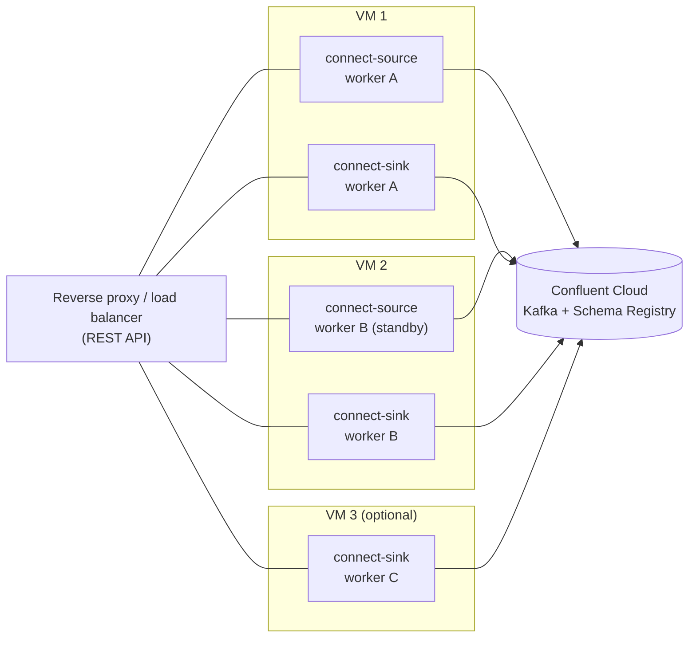

### What each cluster gains
| Cluster | Connector tasks | What more VMs give you |
|---|---|---|
| `connect-source` | Debezium SQL Server runs **one task only** (`tasks.max=1`: the transaction log is read sequentially) | **High availability**: worker B is an idle standby; if VM 1 dies, the task restarts on VM 2 (offsets are in Kafka, the schema history in its topic) and resumes from the last committed LSN. No throughput gain. |
| `connect-sink` | Each sink runs up to `tasks.max` tasks, each reading a share of the topic partitions | **Availability and scale**: tasks are rebalanced across the VMs. Throughput only scales if the topics have **more than one partition** (this demo uses one: set a higher count in `terraform/main.tf` first) and `tasks.max` is raised. |

### How to run it
1. **Same image on every VM**: build `connect/` once, push it to a registry and `docker pull` it on each VM, so all workers have identical plugin versions (a mixed-version cluster misbehaves during rebalances).
2. **Same cluster settings on every VM of a cluster**: `CONNECT_GROUP_ID`, `CONNECT_*_STORAGE_TOPIC`, the converters, the `CONNECT_CONNECTOR_CLIENT_CONFIG_OVERRIDE_POLICY` and the credentials of the worker. Nothing else is shared, there is no VM-to-VM configuration.
3. **Only one setting differs per VM, the advertised address**. Workers forward REST requests to the leader, so `CONNECT_REST_ADVERTISED_HOST_NAME` must be an address the other VMs can reach (the VM's private DNS name or IP, not `connect-source`) and port `8083` must be open between the VMs (and only to them and your operations network):

```yaml
# docker-compose.yml on each VM (excerpt); VM_HOSTNAME is the VM's private DNS name
services:
  connect-sink:
    image: registry.example.com/db-replication-connect:<pinned-version>   # same on every VM
    restart: unless-stopped
    ports: ["8083:8083"]
    environment:
      CONNECT_REST_ADVERTISED_HOST_NAME: ${VM_HOSTNAME}
      CONNECT_REST_ADVERTISED_PORT: 8083
      CONNECT_GROUP_ID: db-replication-connect-sink            # identical on all VMs of this cluster
      CONNECT_CONFIG_STORAGE_TOPIC: docker-connect-sink-configs
      CONNECT_OFFSET_STORAGE_TOPIC: docker-connect-sink-offsets
      CONNECT_STATUS_STORAGE_TOPIC: docker-connect-sink-status
      # ... same bootstrap / SASL / converter settings as in docker-compose.yml, secrets from your secret store
```
4. **Reach the databases from every VM.** The connector configs use the Docker names `mssql`, `postgres` and `db2`; on separate VMs use the databases' real DNS names (parameterise them in `gen_connectors.py`), because a connector task can run on **any** worker of its cluster. Open the firewall from **all** VMs of a cluster to the database it uses.
5. **Deploy connectors once, to any worker** (`PUT /connectors/<name>/config` against the load balancer or any VM): the config is stored in Kafka and the cluster distributes the tasks. Do not post the same connector to each VM.
6. **Put the REST API behind one stable name** (internal load balancer or reverse proxy with TLS and authentication) with a health check on `GET /`, so deployment scripts and monitoring do not depend on one VM.
7. **Spread across failure domains**: put the VMs in different availability zones or racks, and use at least **2 VMs per cluster** (3 for sinks that must survive a failure under load, so the survivors have headroom). Size each VM to run **all** tasks of its cluster if the others fail.
8. **Rolling upgrades**: update one VM at a time and wait until its worker has rejoined and tasks are `RUNNING` before the next one. Use `scheduled.rebalance.max.delay.ms` (default 5 minutes) so a short restart does not trigger a full reshuffle, and the default `connect.protocol=sessioned` / incremental cooperative rebalancing so a join or leave only moves the affected tasks.
9. **Separate by workload when it helps**: you can run a third cluster for heavy sinks, or one sink cluster per target database, using the same pattern (own group id, own internal topics, own service account).

For orchestrators, the same design maps directly: Docker Swarm (`deploy.replicas: 2` with `placement.max_replicas_per_node: 1`) or Kubernetes (a `Deployment` or Confluent for Kubernetes `Connect` resource with 2+ replicas and pod anti-affinity) keep the number of workers constant and restart them, while Connect itself handles task placement.

## Notes

* Fixed container names and ports are shared with the local-only demo: **run one demo at a time** (`start.sh` tells you to stop the other one).
* Deletes work as in the local demo: the source emits a tombstone (key + null value), and the sinks delete the row (`delete.enabled=true` with `pk.mode=record_key`).
* If Terraform gets a `401`/`403` right after creating the cluster, RBAC role bindings and API keys may still be propagating. Run `./start.sh` again; it continues where it stopped.
* If a Kafka Connect worker cannot start, `start.sh` prints its log. Usual causes are incorrect Confluent Cloud credentials or no outbound access to `*.confluent.cloud:9092`.

## Confluent Cloud references

* [Microsoft SQL Server CDC Source V2 (Debezium) for Confluent Cloud](https://docs.confluent.io/cloud/current/connectors/cc-microsoft-sql-server-source-cdc-v2-debezium/cc-microsoft-sql-server-source-cdc-v2-debezium.html)
* [PostgreSQL Sink for Confluent Cloud](https://docs.confluent.io/cloud/current/connectors/cc-postgresql-sink.html)
* [Manage API Keys in Confluent Cloud](https://docs.confluent.io/cloud/current/security/authenticate/workload-identities/service-accounts/api-keys/manage-api-keys.html)
* [Lightning Tables overview](https://docs.confluent.io/cloud/current/lightning-tables/overview.html), [manage](https://docs.confluent.io/cloud/current/lightning-tables/manage.html) and [query with JDBC](https://docs.confluent.io/cloud/current/lightning-tables/query/jdbc.html)
* [Confluent Cloud managed MCP server](https://docs.confluent.io/cloud/current/ai/ai-tools/managed-mcp-server.html)

## Confluent Platform references

* [Debezium SQL Server CDC Source Connector for Confluent Platform](https://docs.confluent.io/kafka-connectors/debezium-sqlserver-source/current/overview.html)
* [JDBC Sink Connector for Confluent Platform](https://docs.confluent.io/kafka-connectors/jdbc/current/sink-connector/overview.html)
