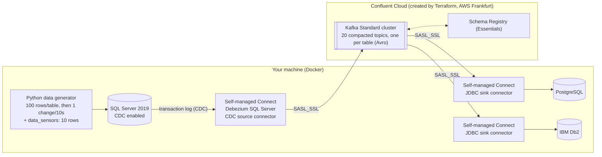

# Database replication with Confluent Cloud: SQL Server → Kafka + Schema Registry → PostgreSQL + IBM Db2

Same demo as the [local-only version](../README.md) (same 20 tables, same data generator, same connectors, same databases), but **Kafka and Schema Registry run in Confluent Cloud**, created for you by Terraform. Only the data side (the Python generator, the three databases and the self-managed connectors) stays on your machine, in Docker:



Everything reusable is reused from the parent folder (data generator, database init scripts, Connect image, CloudBeaver setup, verify script); this folder only adds what is different:

| File | What |
|---|---|
| `terraform/` | Environment, Kafka cluster, Schema Registry, service accounts, role bindings, API keys and topics |
| `docker-compose.yml` | Databases, data generator, CloudBeaver and a **self-managed Connect worker pointed at Confluent Cloud** (no local broker / Schema Registry / Control Center) |
| `connectors/` | The same 3 connectors, with Cloud credentials injected from the worker's environment (`${env:CC_...}`), so the files hold **no secrets** |
| `start.sh`, `stop.sh`, `deploy-connectors.sh`, `verify.sh` | Cloud-aware versions of the local scripts |
| `scripts/` | Helpers (`gen_connectors.py` regenerates `connectors/`) |

## What Terraform creates

| Resource | Details |
|---|---|
| Environment | `db-replication-xxxxxx` (random 6-character suffix), Stream Governance package **Essentials** |
| Kafka cluster | **Standard**, **AWS Frankfurt (`eu-central-1`)**, single zone |
| Schema Registry | **Essentials**, provisioned by Confluent for the environment; its endpoint is read back by Terraform |
| Service accounts | `app-manager` (creates the topics), `sr` (Schema Registry key), `client` (Connect worker and connectors) with their role bindings and API keys |
| Topics | One compacted topic per table (20), the Connect internal topics and the Debezium schema history topic |

The settings are plain Terraform variables with defaults in [`terraform/vars.tf`](terraform/vars.tf) (`cc_cloud_provider`, `cc_cloud_region`, `cc_env_name`, `cc_cluster_name`, `cc_availability`, `stream_governance`). Override any of them with `TF_VAR_...`, for example another region:

```bash
TF_VAR_cc_cloud_region=eu-west-1 ./start.sh
```

## Prerequisites

* A **Confluent Cloud account** and a **Cloud API key** (*Cloud resource management*, not a Kafka cluster key) allowed to create environments: Confluent Cloud → menu (top right) → *API keys* → *Add API key* → *My account* (or a service account with the *OrganizationAdmin* role) → *Cloud resource management*.
* Docker, or **Colima** on macOS (`brew install colima`): `start.sh` starts it, `stop.sh` stops it (see the [main README](../README.md#requirements--caveats) for sizing and the Db2 note).
* **Terraform is optional.** If `terraform` is not installed the scripts run the official `hashicorp/terraform` Docker image instead (force it with `TF_USE_DOCKER=1`). The repository must live under your home folder for that (Colima shares only `$HOME` with the VM).
* Internet access (Confluent Cloud, Maven for the Db2 JDBC driver, container images).

## Run

```bash
cd confluent_cloud
./start.sh                 # prompts for CONFLUENT_CLOUD_API_KEY / CONFLUENT_CLOUD_API_SECRET, creates the
                           # cloud resources, then starts the local databases, generator and Connect
./deploy-connectors.sh     # SQL Server CDC source + Postgres sink + Db2 sink   (or: source | sinks)
./verify.sh                # per-table row counts: SQL Server vs Postgres vs Db2
./stop.sh                  # removes the local stack, asks whether to destroy the cloud resources too
```

* **Credentials** are read from `CONFLUENT_CLOUD_API_KEY` / `CONFLUENT_CLOUD_API_SECRET` if already exported, otherwise `start.sh` asks for them (the secret is not echoed). They are never written to disk. Terraform needs them again for `./stop.sh` if you choose to destroy.
* `start.sh` ends by printing the **Confluent Cloud console link** for the new cluster, the Schema Registry endpoint and the local URLs. CloudBeaver (http://localhost:8978) comes with the three database connections pre-loaded, as in the local demo.
* Non-interactive use: `ASSUME_YES=1 ./start.sh`, `DESTROY_CLOUD=1 ./stop.sh`, `KEEP_COLIMA=1 ./stop.sh`.
* `SKIP_TERRAFORM=1 ./start.sh` reuses the already deployed environment (`cloud.env`) without running Terraform.
* **Every start is a clean demo**: the local databases are recreated and Terraform recreates the (empty) topics, so SQL Server, Kafka and both targets always begin in sync.
* Same change speed settings as the local demo: `OPS_INTERVAL_SECONDS` and `SENSOR_INTERVAL_SECONDS` (default 10 seconds).

Watch it work in Confluent Cloud (topics, messages with tombstones, schemas, consumer lag of the two sink groups) and compare the three databases in CloudBeaver. See the [main README](../README.md#see-it-in-action) for screenshots.

## Test it

Once `./start.sh` and `./deploy-connectors.sh` have finished (connectors `RUNNING`), check that the three databases follow each other:

**1. Row counts**: `./verify.sh` compares every table in SQL Server, PostgreSQL and Db2 (a difference of 1-2 rows right after a change is normal, re-run it).

**2. CloudBeaver** (http://localhost:8978, no login needed): the folder *Replication demo* holds the three connections, **1 - SQL Server (source)**, **2 - PostgreSQL (target)** and **3 - IBM Db2 (target)**. Open an SQL editor on each one (click the connection, then *SQL*) and run the same query:

| Connection | Query |
|---|---|
| SQL Server | `select * from data_sensors order by updated_at desc;` |
| PostgreSQL | `select * from data_sensors order by updated_at desc;` |
| IBM Db2 | `select * from "data_sensors" order by "updated_at" desc;` (Db2 names are lowercase and quoted) |

`data_sensors` always has 10 rows and changes every 10 seconds: re-run the query on the three tabs and the rows (and `sensor_id`s, as sensors are replaced) match. The first connection to SQL Server / Db2 downloads the JDBC driver, so it needs internet access.

**3. Push your own change** and watch it arrive (SQL Server → Confluent Cloud → both targets). Run it on the source connection in CloudBeaver, then query the other two:

```sql
update dbo.customers set customer_tier = 'PLATINUM' where customer_id = 1;   -- replicated as an upsert
delete from dbo.addresses where address_id = (select min(address_id) from dbo.addresses);   -- replicated as a tombstone, the row disappears from both targets
```

**4. Confluent Cloud console** (the link is printed at the end of `start.sh`): open the cluster and look at
* *Topics* → `data_sensors` → *Messages*: key = primary key, value = the row; a delete shows up as a record with a `null` value (tombstone). *Schema* tab: the Avro schema registered in Schema Registry.
* *Connectors*: none (they run in your Docker, self-managed); *Consumers*: groups `connect-postgres-sink` and `connect-db2-sink` with their lag.
* *Environment* → *Stream Governance*: the Essentials Schema Registry with one subject pair (`-key` / `-value`) per table.

**5. Connectors from the command line**: `curl -s localhost:8083/connectors?expand=status`, or `docker logs -f connect`.

## Destroy it (and cost)

A Standard cluster and the Stream Governance package are **billed while they exist**, so destroy the cloud resources when you are done:

```bash
./stop.sh                                   # removes the local stack, asks "destroy the Confluent Cloud environment?" -> y
DESTROY_CLOUD=1 ./stop.sh                   # same, without asking (still needs the API key/secret: exported or prompted)
DESTROY_CLOUD=0 KEEP_COLIMA=1 ./stop.sh     # only stop the local containers, keep the cloud environment and the Colima VM
```

Destroying runs `terraform destroy`: the environment, cluster, topics, service accounts and API keys are all removed (about a minute). The local containers and their volumes are always removed by `stop.sh`; Colima is stopped too unless `KEEP_COLIMA=1`.

Terraform state is kept locally in `terraform/terraform.tfstate`. If you ever lose it without destroying first, delete the `db-replication-xxxxxx` environment in the Confluent Cloud console instead (deleting the environment removes everything inside it).

## How the local worker connects to Confluent Cloud

* The Connect worker (`docker-compose.yml`) uses `SASL_SSL` + `PLAIN` with the `client` service account's API key for the worker itself and for the producers, consumers and admin client it creates, and Avro converters with Schema Registry basic auth (`USER_INFO`).
* Connector configs reference credentials as `${env:CC_KAFKA_API_KEY}`, `${env:CC_SR_API_SECRET}`, ... resolved by Kafka's `EnvVarConfigProvider` from the worker's environment (filled from `cloud.env`), so they never appear in the JSON files or in the Connect REST API output. Debezium's schema history client gets the same settings under `schema.history.internal.producer|consumer|admin.*`.
* Kafka Connect's internal topics and the Debezium schema history topic are created by Terraform (Confluent Cloud fixes replication factor 3), the table topics too, so connectors need no topic-creation rights at runtime.
* `cloud.env` (API keys, Kafka / Schema Registry endpoints) and the Terraform state contain secrets: both are git-ignored.

## Notes

* Fixed container names and ports are shared with the local-only demo: **run one at a time** (`start.sh` tells you to stop the other).
* Deletes work like in the local demo: the source emits a tombstone (key + null value) and the sinks delete the row (`delete.enabled=true` with `pk.mode=record_key`).
* If Terraform fails with a `401`/`403` right after creating the cluster, role bindings and API keys are still propagating: run `./start.sh` again, it continues where it stopped.
* If Connect cannot start, `start.sh` prints its log; the usual causes are wrong Cloud credentials or no outbound access to `*.confluent.cloud:9092`.
