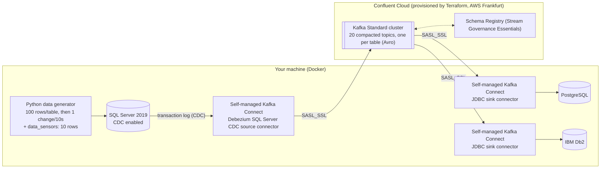
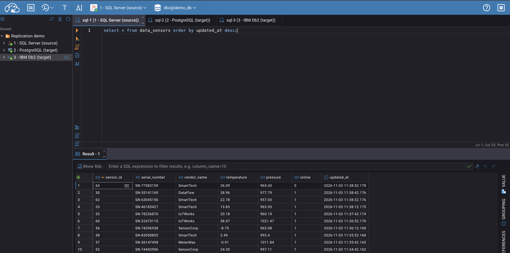
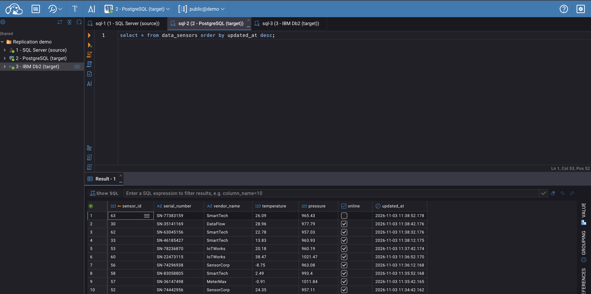
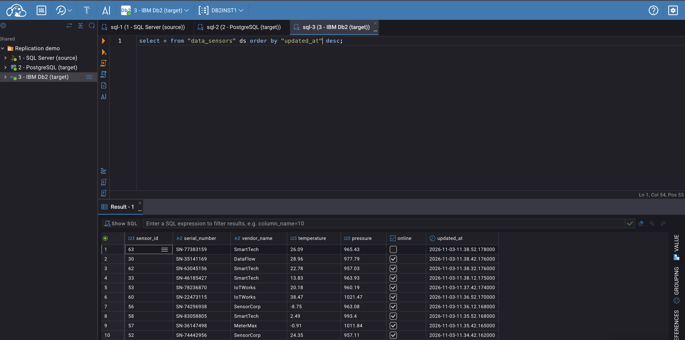

# Database replication with Confluent Cloud: SQL Server → Kafka + Schema Registry → PostgreSQL + IBM Db2

Same demo as the [local-only version](../README.md) (same 20 tables, data generator, connectors and databases), but the Kafka cluster and Schema Registry are provisioned in Confluent Cloud by Terraform. The data plane (Python generator, three databases and self-managed Kafka Connect worker with its connectors) runs locally in Docker:



The demo reuses the parent folder’s data generator, database initialization scripts, Kafka Connect image, CloudBeaver setup and verification script. This folder adds the Confluent Cloud configuration and Cloud-aware orchestration:

| File | What |
|---|---|
| `terraform/` | Confluent Cloud environment, Kafka cluster, Schema Registry, service accounts, RBAC role bindings, API keys and topics |
| `docker-compose.yml` | Databases, data generator, CloudBeaver and a self-managed Kafka Connect worker connected to Confluent Cloud (no local Kafka broker, Schema Registry or Control Center) |
| `connectors/` | The same three connector configurations, with Confluent Cloud credentials injected from the worker environment (`${env:CC_...}`), so the files contain no secrets |
| `start.sh`, `stop.sh`, `deploy-connectors.sh`, `verify.sh` | Cloud-aware versions of the local scripts |
| `scripts/` | Helpers (`gen_connectors.py` regenerates `connectors/`) |

## What Terraform creates

| Resource | Details |
|---|---|
| Environment | `db-replication-xxxxxx` (random 6-character suffix), with Stream Governance Essentials |
| Kafka cluster | Standard cluster, AWS Frankfurt (`eu-central-1`), single zone |
| Schema Registry | Stream Governance Essentials Schema Registry, provisioned for the environment; Terraform reads back its endpoint |
| Service accounts | `app-manager` (creates topics), `sr` (Schema Registry access), `client` (Kafka Connect worker and connectors), with role bindings and API keys |
| Topics | One compacted Kafka topic per table (20), Kafka Connect internal topics and the Debezium schema history topic |

The settings are plain Terraform variables with defaults in [`terraform/vars.tf`](terraform/vars.tf) (`cc_cloud_provider`, `cc_cloud_region`, `cc_env_name`, `cc_cluster_name`, `cc_availability`, `stream_governance`). Override any of them with `TF_VAR_...`, for example to use another region:

```bash
TF_VAR_cc_cloud_region=eu-west-1 ./start.sh
```

## Prerequisites

* A **Confluent Cloud account** and a **Cloud API key scoped for Cloud resource management** (not a Kafka cluster or Schema Registry API key). Create it from Confluent Cloud’s **API keys** page by choosing **Add API key** and the **Cloud resource management** scope. The key owner needs sufficient permissions to create the resources managed by Terraform; for this demo, use an account with the required organization-level permissions. See Confluent’s [Manage API Keys in Confluent Cloud documentation](https://docs.confluent.io/cloud/current/security/authenticate/workload-identities/service-accounts/api-keys/manage-api-keys.html) for the current steps and role requirements.
* Docker, or **Colima** on macOS (`brew install colima`): `start.sh` starts it and `stop.sh` stops it (see the [main README](../README.md#requirements--caveats) for sizing and the Db2 note).
* **Terraform is optional.** If `terraform` is not installed, the scripts use the official `hashicorp/terraform` Docker image instead (force this with `TF_USE_DOCKER=1`). The repository must live under your home folder for this option because Colima shares only `$HOME` with the VM.
* Internet access for Confluent Cloud, Maven (Db2 JDBC driver) and container images.

## Run

```bash
cd confluent_cloud
./start.sh # prompts for CONFLUENT_CLOUD_API_KEY / CONFLUENT_CLOUD_API_SECRET, provisions the Cloud resources, then starts the local databases, generator and Kafka Connect worker
./deploy-connectors.sh # SQL Server CDC source + PostgreSQL sink + Db2 sink (or: source | sinks)
./verify.sh # per-table row counts: SQL Server vs PostgreSQL vs Db2
./stop.sh # removes the local stack and asks whether to destroy the Cloud resources too
```

* Credentials are read from `CONFLUENT_CLOUD_API_KEY` / `CONFLUENT_CLOUD_API_SECRET` if already exported; otherwise `start.sh` prompts for them (the secret is not echoed). They are never written to disk. Terraform needs them again if you choose to destroy the Cloud resources with `./stop.sh`.
* At the end, `start.sh` prints the **Confluent Cloud console link** for the new Kafka cluster, the Schema Registry endpoint and the local URLs. CloudBeaver (`http://localhost:8978`) has the three database connections preloaded, as in the local demo.
* Non-interactive use: `ASSUME_YES=1 ./start.sh`, `DESTROY_CLOUD=1 ./stop.sh`, `KEEP_COLIMA=1 ./stop.sh`.
* `SKIP_TERRAFORM=1 ./start.sh` reuses the already deployed environment (`cloud.env`) without running Terraform.
* **Every start is a clean demo:** the local databases are recreated and Terraform recreates the empty Kafka topics, so SQL Server, Kafka and both targets begin in sync.
* The change intervals are the same as in the local demo: `OPS_INTERVAL_SECONDS` and `SENSOR_INTERVAL_SECONDS` (default 10 seconds).

Watch the demo in Confluent Cloud (topics, messages with tombstones, schemas and consumer lag for the two sink consumer groups) and compare the three databases in CloudBeaver. See the [main README](../README.md#see-it-in-action) for screenshots.

## Test it

Once `./start.sh` and `./deploy-connectors.sh` have finished and the connectors show `RUNNING`, check that the three databases follow each other:

**1. Row counts:** `./verify.sh` compares every table in SQL Server, PostgreSQL and Db2. A difference of 1–2 rows just after a change is normal; rerun the check.

**2. CloudBeaver** (`http://localhost:8978`, no login needed): the *Replication demo* folder holds the three connections: **1 - SQL Server (source)**, **2 - PostgreSQL (target)** and **3 - IBM Db2 (target)**. Open an SQL editor on each connection and run the same query:

| Connection | Query |
|---|---|
| SQL Server | `select * from data_sensors order by updated_at desc;` |
| PostgreSQL | `select * from data_sensors order by updated_at desc;` |
| IBM Db2 | `select * from "data_sensors" order by "updated_at" desc;` (Db2 names are lowercase and quoted) |

`data_sensors` always has 10 rows and changes every 10 seconds. Rerun the query in all three tabs; the rows (and `sensor_id`s, as sensors are replaced) should match. The first connection to SQL Server or Db2 downloads the JDBC driver, so it needs internet access.

**3. Push your own change** and watch it arrive (SQL Server → Confluent Cloud → both targets). Run these statements on the SQL Server connection in CloudBeaver, then query the other two databases:

```sql
update dbo.customers set customer_tier = 'PLATINUM' where customer_id = 1; -- replicated as an upsert
delete from dbo.addresses where address_id = (select min(address_id) from dbo.addresses); -- replicated as a tombstone; the row disappears from both targets
```

**4. Confluent Cloud console** (the link is printed at the end of `start.sh`): open the Kafka cluster and inspect:

* **Topics** → `data_sensors` → **Messages**: the key is the primary key and the value is the row. A delete appears as a record with a `null` value (a tombstone). The **Schema** tab shows the Avro schema registered in Schema Registry.
* **Connectors**: none are listed in Confluent Cloud because the Kafka Connect worker and connectors run in your Docker environment. **Consumers** shows the `connect-postgres-sink` and `connect-db2-sink` groups and their lag.
* **Environment** → **Stream Governance**: the Essentials Schema Registry, with one subject pair (`-key` / `-value`) per table.

**5. Kafka Connect from the command line:** `curl -s localhost:8083/connectors?expand=status`, or `docker logs -f connect`.

## Visualise the data

The replicated data lives in three databases on your machine, so you can look at it either in a web SQL client (CloudBeaver) or straight from the command line.

### CloudBeaver (web)

Open **http://localhost:8978**. No login is needed: the *Replication demo* folder already contains the three connections (**1 - SQL Server (source)**, **2 - PostgreSQL (target)** and **3 - IBM Db2 (target)**), shared with everybody by `../scripts/cloudbeaver-setup.sh`, which `start.sh` runs. Click a connection, open an SQL editor (**SQL** button) and run the query from step 2 of [Test it](#test-it), one tab per database. The administrator login is `cbadmin` / `Admin123`. The first connection to SQL Server or Db2 downloads its JDBC driver, so it needs internet access.

The same `data_sensors` query on the source and on both targets returns identical rows (`online` is a `BIT` in SQL Server, shown as 0/1, and a `BOOLEAN` in PostgreSQL and Db2):

SQL Server (source):



PostgreSQL (target):



IBM Db2 (target):



### Command line

The databases run in Docker containers, so `docker exec` is all you need (nothing to install). Any of the 20 tables works, here `orders`:

```bash
docker exec postgres psql -U postgres -d demo -c 'select * from orders order by order_id desc limit 5'
docker exec db2 su - db2inst1 -c 'db2 connect to demo && db2 "select * from \"orders\" order by \"order_id\" desc fetch first 5 rows only"'
docker exec mssql /opt/mssql-tools18/bin/sqlcmd -C -S localhost -U sa -P 'Password!123' -d demo_db -Q 'select top 5 * from dbo.orders order by order_id desc'
```

For the small, always-moving `data_sensors` table (10 rows, a change every 10 seconds; about 70% updates and 30% replacements where a sensor is deleted and a new one inserted), run these in 3 terminals (or in the 3 CloudBeaver tabs) and watch them follow each other:

```bash
docker exec mssql /opt/mssql-tools18/bin/sqlcmd -C -S localhost -U sa -P 'Password!123' -d demo_db -Q 'select * from dbo.data_sensors order by sensor_id'
docker exec postgres psql -U postgres -d demo -c 'select * from data_sensors order by sensor_id'
docker exec db2 su - db2inst1 -c 'db2 connect to demo > /dev/null && db2 "select * from \"data_sensors\" order by \"sensor_id\""'
```

Notes: Db2 table and column names are lowercase and **quoted** (`"orders"`, `"order_id"`). To see the changes arrive faster, shorten the generator intervals, for example `OPS_INTERVAL_SECONDS=1 SENSOR_INTERVAL_SECONDS=1 ./start.sh`, or on a running stack `OPS_INTERVAL_SECONDS=2 SENSOR_INTERVAL_SECONDS=2 docker compose up -d data-generator` (use `docker-compose` if you have the standalone binary).

## Destroy it (and cost)

A Standard cluster and the Stream Governance package are **billed while they exist**, so destroy the Confluent Cloud resources when you are done:

```bash
./stop.sh # removes the local stack, then asks "destroy the Confluent Cloud environment?" -> y
DESTROY_CLOUD=1 ./stop.sh # same, without asking; still needs the API key/secret (exported or prompted)
DESTROY_CLOUD=0 KEEP_COLIMA=1 ./stop.sh # only stop the local containers; keep the Cloud environment and Colima VM
```

Destroying runs `terraform destroy`: the environment, Kafka cluster, Schema Registry, topics, service accounts and API keys are removed (about a minute). The local containers and their volumes are always removed by `stop.sh`; Colima is stopped too unless `KEEP_COLIMA=1`.

Terraform state is kept locally in `terraform/terraform.tfstate`. If you lose it without destroying first, delete the `db-replication-xxxxxx` environment in the Confluent Cloud console instead; deleting the environment removes everything inside it.

## How the local Kafka Connect worker connects to Confluent Cloud

* The Kafka Connect worker (`docker-compose.yml`) uses `SASL_SSL` + `PLAIN` with the `client` service account’s Kafka API key for the worker and the producers, consumers and admin client it creates. Avro converters authenticate to Schema Registry with Schema Registry API key/secret using `USER_INFO`.
* Connector configurations reference credentials as `${env:CC_KAFKA_API_KEY}`, `${env:CC_SR_API_SECRET}`, etc. Kafka Connect’s `EnvVarConfigProvider` resolves them from the worker environment (populated from `cloud.env`), so credentials do not appear in the JSON files or Kafka Connect REST API output. Debezium’s schema history client uses the same settings under `schema.history.internal.producer|consumer|admin.*`.
* Kafka Connect internal topics, the Debezium schema history topic and the table topics are created by Terraform. Confluent Cloud sets the replication factor to 3, so the connectors do not need topic-creation permissions at runtime.
* `cloud.env` (API keys, Kafka and Schema Registry endpoints) and the Terraform state contain sensitive values; both are git-ignored.

## Notes

* Fixed container names and ports are shared with the local-only demo: **run one demo at a time** (`start.sh` tells you to stop the other one).
* Deletes work as in the local demo: the source emits a tombstone (key + null value), and the sinks delete the row (`delete.enabled=true` with `pk.mode=record_key`).
* If Terraform gets a `401`/`403` right after creating the cluster, RBAC role bindings and API keys may still be propagating. Run `./start.sh` again; it continues where it stopped.
* If the Kafka Connect worker cannot start, `start.sh` prints its log. Usual causes are incorrect Confluent Cloud credentials or no outbound access to `*.confluent.cloud:9092`.

## Confluent Cloud references

* [Microsoft SQL Server CDC Source V2 (Debezium) for Confluent Cloud](https://docs.confluent.io/cloud/current/connectors/cc-microsoft-sql-server-source-cdc-v2-debezium/cc-microsoft-sql-server-source-cdc-v2-debezium.html)
* [PostgreSQL Sink for Confluent Cloud](https://docs.confluent.io/cloud/current/connectors/cc-postgresql-sink.html)
* [Manage API Keys in Confluent Cloud](https://docs.confluent.io/cloud/current/security/authenticate/workload-identities/service-accounts/api-keys/manage-api-keys.html)

## Confluent Platform references

* [Debezium SQL Server CDC Source Connector for Confluent Platform](https://docs.confluent.io/kafka-connectors/debezium-sqlserver-source/current/overview.html)
* [JDBC Sink Connector for Confluent Platform](https://docs.confluent.io/kafka-connectors/jdbc/current/sink-connector/overview.html)
